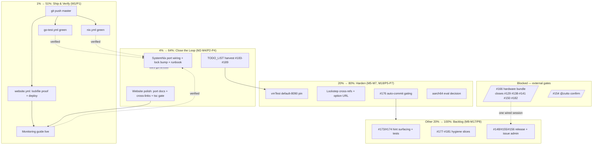

# SUPERB Plan — SystemNix Closeout + Backlog Pareto (2026-10-19_04-29)

**Scope:** Everything open after the 2026-10-19 SystemNix-extraction session (status report `docs/status/2026-10-19_04-19_systemnix-extraction-port-option-monitoring-guide.md`) merged with the living backlog (`TODO_LIST.md`, rows #129–#182). Point-in-time plan; the living truth stays in `TODO_LIST.md`.

**Session recap (what already shipped, locally):** `hardware.emeet-pixy.port` option wiring `EMEET_PIXYD_WEB_ADDR` (loopback-fixed), vmTest pin (`port = 8091` + rendered-env assertion, ran green), website Monitoring & Health guide + sidebar, CHANGELOG + AGENTS.md entries, pre-existing `pnpm-lock.yaml` drift repaired. **Nothing is pushed yet** — local master is ahead with auto-commits (`b109788` newest).

**Audit errata (closed questions from the status report):**
- `b109788` non-authored hunks = **benign**: `templates_templ.go` is a newer templ-generator regeneration (`var x =` → `x :=`, import merge — no semantic change, generated file); `website/flake.nix` dropped one unused input. No action needed; recorded here so nobody re-audits.
- Lockfile drift: fixed this session (plain `pnpm install` + green build); frozen-lockfile PROOF still pending → task P2-9.

---

## Pareto Breakdown

### The 1% that delivers 51% — SHIP IT
**Push master.** Everything this session produced is unpushed and CI-unverified; the monitoring guide is undeployed; SystemNix cannot pin the new revision until it lands. One `git push` converts all local "verified by me" claims into "verified by CI + live on the website". Everything else queues behind it.

### The 4% that delivers 64% — CLOSE THE LOOP
1. **Website polish bundle** — document `port` where users look for it (configuration guide), cross-link the new guide, prove the frozen-lockfile gate, run the strict type gate.
2. **TODO_LIST harvest** — the session's follow-ups become rows #183–#189 so they outlive this snapshot (done as part of this plan's commit).
3. **SystemNix port wiring** (GATED on Lars's go-ahead, cross-repo) — the entire motivation for `port`; without it the coupling stays conventional.

### The 20% that delivers 80% — HARDEN
4. vmTest default-port pin (the 8090 convention SystemNix relies on is asserted only by the non-default test today).
5. #176 auto-commit daemon gating on a green pre-commit build — this session literally lived the failure class (heuristic commit mixing unrelated churn); HIGH/M per backlog.
6. Lockstep cross-references (module default ↔ `pixy.DefaultWebAddr`) + guide URL in the option description.
7. aarch64 eval coverage decision.

### The other 20% (to reach 100%) — BACKLOG & BLOCKED
The unblocked backlog hygiene (#173/#174 hint surfacing + tests, #177 BuildFlow ruff scoping, #178 benchmark delta, #179 preset-name validation, #180 .crushrc alignment, #181 nolint sweep), release/issue admin (#148 upstream PR, #154 issue close, #155 v0.4.1, #156 branch protection), and the hardware-gated cluster (#166 bundle → #129, #138–#141, #150, #182) which only a wired PIXY session can move.

---

## Medium Plan — 30–100 min tasks (sorted by impact ↓, effort ↑)

| ID | Task | Impact | Effort | Est | Customer value | Gate |
| -- | ---- | ------ | ------ | --- | -------------- | ---- |
| M1 | Push master; watch all three workflows (go-test, nix, website) go green; verify monitoring guide live on emeet-pixyd.lars.software | HIGH | S | 45m | Docs shipped, CI-verified build | — |
| M2 | Website polish bundle: `port` in configuration.mdx, metrics↔monitoring + quickshell↔monitoring cross-links, frozen-lockfile proof, `tsc --strict`, rebuild+grep, push | HIGH | S | 90m | Option documented where users search; CI gates proven | after M1 |
| M3 | SystemNix: bump emeet-pixyd lock to pushed rev, set `hardware.emeet-pixy.port = ports.emeet-pixyd`, update runbook, eval-check | HIGH | S | 30m | Port registry becomes authoritative | **Lars go-ahead** (cross-repo) |
| M4 | TODO_LIST harvest: rows #183–#189 + Updated header; commit | MED | S | 30m | Backlog truth; no entombed tasks | — (folded into this plan's commit) |
| M5 | #176: gate auto-commit daemon on green pre-commit build (design → implement → test with a deliberately broken staged file) | HIGH | M | 100m | Kills red-at-HEAD commit class | design review |
| M6 | vmTest default-port pin: second node (or `nix eval` assertion) proves unset-port renders `127.0.0.1:8090`; run vmTest | MED | S | 60m | 8090 convention pinned, not implied | — |
| M7 | Lockstep cross-refs: comment pairs module default ↔ `pixy.DefaultWebAddr`; monitoring-guide URL into `port` option description; fmt + flake check | LOW | S | 30m | Drift between Go default and module default becomes loud | — |
| M8 | #173: surface unsupported-device hint in web UI offline panel + Waybar (gated on ADR answer) | MED | M | 100m | Non-PIXY EMEET owners get answers in-product | ADR answer |
| M9 | #174: branch tests for hint paths (`probe`/`device` output + rate-limited log branch) | MED | S | 60m | Hint behavior pinned | after M8 |
| M10 | #177: scope BuildFlow ruff away from `tools/` (or ruff-clean, SIM115 ×20) so the dev gate is green for Go work | MED | S | 30m | Developer loop unblocked | — |
| M11 | #178: benchmark delta — `ttlCache[T]` + preset double-RLock perf-neutral post-refactor | LOW | S | 30m | Refactor safety proven | — |
| M12 | #179: decide + implement always-`ValidatePresetName` in web preset action (400 for garbage) | LOW | S | 30m | Consistent name validation | Lars decision |
| M13 | #180: align `.crushrc` LSP lint config with `.golangci.yml` (drop golines/wsl_v5 noise) | LOW | S | 30m | LSP signal matches CI | — |
| M14 | #181: mechanical nolint sweep (nolintlint- or grep-driven), remove rotted directives | MED | M | 100m | Honest suppression surface | — |
| M15 | #148: send staged innoextract 6.6.1 upstream PR (draft body from `tools/inno661/UPSTREAM.md`) | MED | S | 30m | Upstream contribution lands | **Lars's call** |
| M16 | #156: branch protection requiring the three workflows on master (GitHub settings) | MED | S | 20m | CI becomes load-bearing | **Lars only** (GitHub) |
| M17 | #155: cut v0.4.1 (changelog cut, tag, verify proxy) vs v0.5 — cadence call | MED | S | 60m | Released increment | **Lars cadence call** |
| M18 | aarch64 eval coverage: add `--all-systems` (or equivalent) to nix.yml check, or record accepted gap | LOW | S | 30m | Module eval verified on all shipped platforms | — |
| M19 | #166 hardware bundle (one wired session): full checklist in TODO_LIST — closes #138/#139/#140/#141/#150 partials, #129 screenshots, #182 readback | HIGH | M+ | 100m+/session | Truth for 5+ shipped-but-unverified features | **PIXY attached** |
| M20 | #154: close issue #6 after @zutto's real-hardware confirm | HIGH | S | 10m | Community loop closed | external confirm |
| M21 | #182: `sync` reconciles Speeds/TrackMode from hardware readback | LOW | S | 30m | Sync completeness | blocked on #166 |

**Blocked parking lot (no medium task until unblocked):** #129 (inside M19), #138–#141 (verdicts inside M19), #150 (inside M19), #166 (M19 itself), #154 (M20), #155 (M17), #156 (M16), #182 (M21).

## Fine Plan — ≤12 min tasks (sorted by phase; within phase by impact ↓)

### P1 — Ship & verify (= M1)
| # | Task | Est |
| - | ---- | --- |
| 1 | `git push origin master` (local auto-commits incl. port option, guide, lockfile fix) | 2m |
| 2 | Watch `go-test.yml`: vet → templ generate → lint → govulncheck → race tests → fuzz list-vs-CI assert | 10m |
| 3 | Watch `nix.yml`: `nix flake check --no-build` + package build | 10m |
| 4 | Watch `website.yml`: frozen-lockfile → astro build + CSP patch → ≥19 pages → deploy | 10m |
| 5 | Curl live `/guides/monitoring/` + confirm sidebar entry renders | 5m |

### P2 — Website polish (= M2)
| # | Task | Est |
| - | ---- | --- |
| 6 | Add `port` option section to `guides/configuration.mdx` (env table + module option cross-view) | 12m |
| 7 | Cross-link `guides/metrics.mdx` → `guides/monitoring.mdx` (one-line pointer) | 5m |
| 8 | Cross-link `guides/quickshell.mdx` stale-binary section → monitoring guide trap section | 8m |
| 9 | `pnpm install --frozen-lockfile` — PROVE the CI lockfile gate is green post-regen | 5m |
| 10 | Run the strict type gate (`tsc --strict`; astro check is TS7-broken by design) | 10m |
| 11 | Rebuild website; grep dist for the new content (not the old — deploy-grep gotcha) | 10m |
| 12 | Commit + push website changes (deploy rides `website/**` trigger) | 5m |

### P3 — SystemNix wiring (= M3, GATED)
| # | Task | Est |
| - | ---- | --- |
| 13 | `nix flake update input:emeet-pixyd` in SystemNix to the pushed rev | 8m |
| 14 | Set `hardware.emeet-pixy.port = ports.emeet-pixyd;` in the wrapper module | 5m |
| 15 | Update `SystemNix/docs/services/emeet-pixyd.md` port note (convention → explicit) | 8m |
| 16 | Eval-check SystemNix flake (`nix flake check --no-build` or host eval) | 10m |

### P4 — Backlog truth (= M4, folded into this plan's commit)
| # | Task | Est |
| - | ---- | --- |
| 17 | Insert rows #183–#189 into TODO_LIST.md + new Updated header (old → Previous) | 10m |
| 18 | Verify no duplicate concepts vs existing rows (#129–#182 sweep) | 5m |

### P5 — Default-port pin (= M6)
| # | Task | Est |
| - | ---- | --- |
| 19 | Add second vmTest node (defaults only) asserting `EMEET_PIXYD_WEB_ADDR=127.0.0.1:8090` — or a cheap `nix eval` assertion if a full node is overkill | 12m |
| 20 | Run the vmTest (mostly cached from this session) | 10m |
| 21 | Commit + push | 5m |

### P6 — Lockstep (= M7)
| # | Task | Est |
| - | ---- | --- |
| 22 | Cross-ref comments: `modules/nixos.nix` port default ↔ `internal/pixy/pixy.go` `DefaultWebAddr` (each names the other) | 8m |
| 23 | Add monitoring-guide URL to the `port` option description (renders in NixOS manual/search) | 5m |
| 24 | `nix fmt` + `nix flake check --no-build` | 5m |
| 25 | Commit + push | 4m |

### P7 — #176 auto-commit gating (= M5; design first)
| # | Task | Est |
| - | ---- | --- |
| 26 | Locate the daemon's commit path; check reuse of `scripts/pre-commit` | 12m |
| 27 | Design gate: staged-files lint (fast) vs full build (slow) — pick staged-only | 12m |
| 28 | Implement: failed gate → hold commit + log, never discard work | 12m |
| 29 | Test with a deliberately broken staged `.go` file; confirm hold; fix file | 12m |
| 30 | Document the gate in AGENTS.md Git Workflow note | 8m |

### P8 — Backlog first steps (12m slices; full tasks are M8–M18)
| # | Task | Est |
| - | ---- | --- |
| 31 | #177: add BuildFlow ruff scoping for `tools/` (config edit + one green run) | 10m |
| 32 | #178: run the 9 benchmarks, stash baseline output | 12m |
| 33 | #179: read `presetAction`; write the 3-line decision recommendation for Lars | 12m |
| 34 | #180: diff `.crushrc` lint list vs `.golangci.yml` enabled set; align | 10m |
| 35 | #181: nolint inventory (grep count per file) → chunk plan | 12m |
| 36 | #181 chunk 1: remove rotted directives in test files (test-file exclusions rot most) | 12m |
| 37 | #173: re-read the ADR question + draft the panel-hint design in 5 bullets | 12m |
| 38 | #148: draft the upstream PR body from `tools/inno661/UPSTREAM.md` | 12m |
| 39 | #155: assemble v0.4.1 changelog cut preview (diff [Unreleased] vs v0.4.0) | 12m |
| 40 | M18: try `nix flake check --no-build --all-systems` locally; record aarch64 result | 12m |

### P9 — Blocked parking lot (single parked rows, no slices until unblocked)
| # | Task | Est |
| - | ---- | --- |
| 41 | M19/#166: schedule the wired session when the PIXY is attached (checklist = TODO_LIST #166) | — |
| 42 | M20/#154: ping @zutto for the PIXY 2K confirm | 5m |
| 43 | M16/#156: GitHub branch-protection settings (Lars's console) | 20m |

---

## Execution graph

**Recommended execution order:** P1 → P2 → P4 (in this plan's commit) → P6 → P5 → P3 (once approved) → P7 → P8 slices → blocked lanes as they unlock.

## Verschlimmbessern guardrails (do NOT)

- No `host`/bind option on the module — loopback-only is the security posture; remote exposure goes through an authenticating proxy (documented, decided).
- No duplication of nix checks into `go-test.yml` (a copy without the nix installer silently failed for months — AGENTS.md).
- No CI edit without running the exact command locally first; no TODO_LIST rewrites — additive rows only, harvest discipline.
- No touching the auto-commit daemon beyond adding the gate (#176); heuristic commits are accepted behavior.
- No preset-name, `.crushrc`, or nolint changes beyond their scoped rows.

## Open gates for Lars (cannot be self-answered)

1. **SystemNix cross-repo go-ahead** (M3/P3) — wire `port = ports.emeet-pixyd` there + bump the lock?
2. **#148 / #155 / #156** — upstream PR send, v0.4.1-vs-v0.5 cadence, branch protection: all owner calls.
3. **#166** — when is the next wired PIXY session?
