# SUPERB Plan: v0.5.0-Release-First Pareto Execution Plan

**Date:** 2026-10-31 14:33
**Sources:** `TODO_LIST.md` (rows #129–#194, verified against `CHANGELOG.md` [Unreleased] this session — no stale rows found), architecture review `docs/architecture-understanding/2026-10-31_14-17`, status `docs/status/2026-10-31_14-30`, prior plan `2026-10-19_04-29` (its remainders live on as #183–#189 — not re-derived, carried forward).
**Sort rule everywhere:** importance → impact → effort → customer-value, gated work listed at its tier with the gate named.
**Sizing:** medium tasks 30–100 min (27 total); fine tasks ≤12 min (104 total). Every TODO row #129–#194 is covered exactly once (blocked/decision-gated rows included, with gates).

---

## 1. Pareto Breakdown

### The 1% that delivers 51%

> **Cut and publish v0.5.0 (#155).**

57 unreleased CHANGELOG entries — three new official-protocol HID command families (`speed`, `tracking` variants, `preset push/pull`), the public `/api/status` widget surface, the NixOS `port` option, the monitoring guide, Quickshell guide, structured `[family:code]` errors. **None of it is version-anchored for a single user today.** NixOS consumers pulling the flake get moving-target master with no tag to pin or roll back to. The release work is ~60 minutes; every other task in this plan improves code users cannot yet reference by version. The verdict recorded in #155 already says v0.5.0 (not v0.4.1); the only open question was timing.
**Recommendation: cut it NOW, before the next hardware session.** The #166 session's verdicts are v0.5.1 patch material; coupling the release to hardware availability stalls user value on an event nobody controls. Gated only on Lars's yes.

### The 4% that delivers 64% (the 1% + these)

1. **#190 subprocess timeouts** (MED/S) — a wedged `v4l2-ctl`/`ffmpeg` currently stalls the daemon until the watchdog kills it; HID is bounded at 500ms, the exec paths are not. Trust fix, cheap.
2. **#191 fail-fast socket listen + `degraded` health dimension** (MED/S-M) — the daemon can run `READY=1` with a dead CLI or web surface and no layer observes it. After this, `/api/health` + `/api/status` tell the truth.
3. **#176 gate the auto-commit daemon on a green build** (HIGH/M) — kills the red-at-HEAD class permanently; every future session stops paying the diagnosis tax. Force multiplier for everything below.
4. **#183 SystemNix port wiring** (HIGH/S, gated: Lars's go-ahead) — the only HIGH-impact OPEN row; real downstream consumer value, ~45 min across the repo boundary.

### The 20% that delivers 80% (the above + these)

5. **#166 hardware bundle** (HIGH/M, gated: PIXY attached) — one wired session closes #138/#139/#140/#141/#150 + #129 and un-gates #182/#172. The biggest row-count killer in the backlog, scheduled on an event, not on willpower.
6. **#173 + #174 unsupported-hint surfacing** (MED/M+S, gated: ADR sign-off, which is ready) — user-facing diagnosability for the most common support scenario: "I have an EMEET cam, why no control?"
7. **#179 `ValidatePresetName` in the web preset action** (LOW/S, recommendation ready) — 4-line consistency fix; ships inside any bundle.
8. **#184 + #185 port-option docs + website CI proof** (MED/S+S) — user-facing correctness for what v0.5.0 ships.
9. **#181 nolint sweep chunk 2** (MED/M) — keeps the 0-issues lint gate honest instead of rotting.

### The other 20% to reach 100%

#186 vmTest default-port pin, #187 guide cross-links, #188 aarch64 eval, #189 lockstep comments, #192 trapReasserts drain, #193 WatchdogSec invariant doc, #194 observability additions (new row this plan), #175 SEO pass, #172 shared V2 helper (gated), #148 upstream innoextract PR (gated), #156 branch protection (Lars-only), #154 issue #6 closure (@zutto-gated), plus the session-hygiene pack fixing this session's own report debts. None blocks the 80%; all of it is real.

---

## 2. Gates & Decision Queue (cannot be executed by willpower alone)

<!-- check-rows:ledger --> open Lars/hardware gates — rows route to TODO_LIST, not verdicts
| Gate | Blocks | Owner | This plan's recommendation |
| --- | --- | --- | --- |
| Release timing | T01 (#155) | Lars | Cut v0.5.0 now; hardware verdicts become v0.5.1 |
| ADR sign-off | T11 (#173) | Lars | Option B is complete and recommended — approve |
| Cross-repo go-ahead | T07 (#183) | Lars | ~45 min, HIGH value, do it |
| Upstream PR call | T26 (#148) | Lars | Send it; byte-verified extractor is strong evidence |
| PIXY attached | T08/T09/T10 (#166/#129) | hardware | Prepare checklist; run opportunistically |
| @zutto confirmation | #154 | external | Close when confirmed; no work until then |
| GitHub settings | #156 | Lars (UI-only) | 2 min in the web UI; not CLI-able |
| Lars ADR queue | #116/#123, extraProductIds, erraudit strictness | Lars | Not scheduled; one triage pass with Lars covers all |

---

## 3. Comprehensive Plan — medium tasks (30–100 min, ALL TODOs, sorted)

| ID | Task | TODO# | Impact | Effort | Est | Gate |
| --- | --- | --- | --- | --- | --- | --- |
| ~~T01~~ done — `696e977` — v0.5.0 tagged, GitHub release, proxy verified (TODO #155 DONE) | ~~Cut & publish v0.5.0 (freeze CHANGELOG, gates, tag, GitHub release, verify)~~ | ~~155~~ | ~~**HIGH**~~ | ~~S~~ | ~~60m~~ | ~~Lars timing~~ |
| ~~T02~~ done — `c7eb946` | ~~Subprocess timeouts: constants + ctx wrappers for v4l2/PTZ/stream/notify~~ | ~~190~~ | ~~MED~~ | ~~S~~ | ~~60m~~ | ~~—~~ |
| ~~T03~~ done — `c7eb946` (hangCommander + fake ffmpeg pins) | ~~Hung-commander pinning tests (deadline fires, mutex released)~~ | ~~190~~ | ~~MED~~ | ~~S~~ | ~~45m~~ | ~~—~~ |
| ~~T04~~ done — `c7f98a9` (failfast_test.go) | ~~Fail-fast on startup socket-listen failure~~ | ~~191a~~ | ~~MED~~ | ~~S~~ | ~~40m~~ | ~~—~~ |
| ~~T05~~ done — `e0c2f99` (degraded.go + docs) | ~~`degraded` dimension: track listener deaths, expose in health/status/panel/docs~~ | ~~191b~~ | ~~MED~~ | ~~S-M~~ | ~~90m~~ | ~~—~~ |
| ~~T06~~ **NOT-DO — landed in SystemNix (`d0862d746`/`7ca1bd708`); INERT until NixOS switch — TODO_LIST #176.** | ~~Gate auto-commit daemon on green build (build+vet, hold+notify on red)~~ | ~~176~~ | ~~**HIGH**~~ | ~~M~~ | ~~90m~~ | ~~—~~ |
| ~~T07~~ **NOT-DO — landed locally; deploy pending — TODO_LIST #183.** | ~~SystemNix: port registry entry + module wiring + lock bump + runbook~~ | ~~183~~ | ~~**HIGH**~~ | ~~S~~ | ~~45m~~ | ~~Lars go-ahead~~ |
| ~~T08~~ **NOT-DO — hardware session — owned by TODO_LIST #166 (F038–F044).** | ~~Hardware session A: battery/speed-unit/enum pins + V1-mode decode + map-doc grades~~ | ~~166→138/139/150~~ | ~~**HIGH**~~ | ~~M~~ | ~~100m~~ | ~~PIXY attached~~ |
| ~~T09~~ **NOT-DO — hardware session — owned by TODO_LIST #166 (F045–F050).** | ~~Hardware session B: preset slot sweep + round-trip + tracking variants + trap honesty~~ | ~~166→140/141~~ | ~~**HIGH**~~ | ~~M~~ | ~~100m~~ | ~~PIXY attached~~ |
| ~~T10~~ **NOT-DO — hardware session — owned by TODO_LIST #129/#166.** | ~~Online web-UI screenshots + crops + deploy~~ | ~~129~~ | ~~MED~~ | ~~S~~ | ~~30m~~ | ~~PIXY attached~~ |
| ~~T11~~ done — `ca7a8e3`/`4077e6d`/`d867508` + pma sweep `63169fc` | ~~Unsupported-hint surfacing: webStatus field, panel, Waybar, tests~~ | ~~173~~ | ~~MED~~ | ~~M~~ | ~~90m~~ | ~~ADR sign-off~~ |
| ~~T12~~ done — `c0f7cc4` (probe_unsupported_test.go) | ~~Hint-path branch tests: probe/device output + rate-limited log~~ | ~~174~~ | ~~MED~~ | ~~S~~ | ~~60m~~ | ~~after T11~~ |
| ~~T13~~ done — `4bfa8ac` (code via sweep `1ebf37a`) | ~~`ValidatePresetName` in web preset action + 400 path~~ | ~~179~~ | ~~LOW~~ | ~~S~~ | ~~30m~~ | ~~—~~ |
| ~~T14~~ done — verified already shipped with v0.5.0 (`0c440a3`) | ~~Website config guide: `port` option + loopback rationale + option description~~ | ~~184~~ | ~~MED~~ | ~~S~~ | ~~45m~~ | ~~—~~ |
| ~~T15~~ done — `0c440a3` (frozen-lockfile + tsc proof; CI run 41239839580) | ~~Prove website CI gates: frozen-lockfile + strict TS locally and in workflow~~ | ~~185~~ | ~~MED~~ | ~~S~~ | ~~45m~~ | ~~—~~ |
| ~~T16~~ done — `82ebe53` (16 stale exhaustruct directives) | ~~Nolint sweep chunk 2: inventory + handlers/commands/device + tests~~ | ~~181~~ | ~~MED~~ | ~~M~~ | ~~90m~~ | ~~—~~ |
| ~~T17~~ done — `ddd53b0` (observability_test.go) | ~~Observability: breaker-state gauge, auto-errors counter, ext-deps→degraded, accept ceiling~~ | ~~194~~ | ~~LOW/MED~~ | ~~M~~ | ~~90m~~ | ~~after T05~~ |
| ~~T18~~ done — `d25cc69` | ~~WatchdogSec↔PollInterval invariant comment + cross-refs~~ | ~~193~~ | ~~LOW~~ | ~~S~~ | ~~30m~~ | ~~—~~ |
| ~~T19~~ done — `d25cc69` (TestHandleShutdown_DrainsInFlightTrapReassert) | ~~Drain `trapReasserts` at shutdown + test (or won't-do row)~~ | ~~192~~ | ~~LOW~~ | ~~S~~ | ~~30m~~ | ~~—~~ |
| ~~T20~~ done — verified by full VM run 2026-10-31 (exit 0) | ~~vmTest default-port pin (second node or nix eval assertion)~~ | ~~186~~ | ~~LOW/MED~~ | ~~S~~ | ~~45m~~ | ~~—~~ |
| ~~T21~~ done — `669420b` | ~~Guide cross-links: metrics→monitoring, quickshell→monitoring~~ | ~~187~~ | ~~LOW~~ | ~~S~~ | ~~30m~~ | ~~—~~ |
| ~~T22~~ done — `669420b` + local all-systems check green | ~~aarch64 eval coverage: try all-systems check; wire or record gap~~ | ~~188~~ | ~~LOW~~ | ~~S~~ | ~~45m~~ | ~~—~~ |
| ~~T23~~ done — verified already complete (`d25cc69`) | ~~Lockstep comment pair: module port default ↔ `pixy.DefaultWebAddr`~~ | ~~189~~ | ~~LOW~~ | ~~S~~ | ~~30m~~ | ~~—~~ |
| ~~T24~~ done — `8a256be` (20 OG PNGs; live-verified) | ~~Website SEO: frontmatter audit, OG images for docs, sitemap ping~~ | ~~175~~ | ~~LOW~~ | ~~S~~ | ~~90m~~ | ~~—~~ |
| ~~T25~~ done — `725d8af` (F092–F097) | ~~Session-hygiene pack: TODO header format, report rubric re-score + notes, D2 health diagram, June-review audit~~ | ~~(this session's debts)~~ | ~~LOW~~ | ~~S-M~~ | ~~100m~~ | ~~—~~ |
| ~~T26~~ **NOT-DO — owned by TODO_LIST #148 (Lars’s call).** | ~~Send innoextract 6.6.1 upstream PR~~ | ~~148~~ | ~~MED~~ | ~~S~~ | ~~30m~~ | ~~Lars call~~ |
| ~~T27~~ **NOT-DO — owned by TODO_LIST #172 (gated on #138/#166).** | ~~Shared V2 query helper: extract + migrate identity/power/motor + parity tests~~ | ~~172~~ | ~~LOW~~ | ~~M~~ | ~~90m~~ | ~~#138/#166~~ |

**Blocked rows without tasks:** #154 (external confirmation), #156 (GitHub web UI, 2 min when Lars is in there), #182 (blocked on #166 — its work IS T08's V1-mode decode; row stays blocked until then). Decision queue (#116/#123/extraProductIds/erraudit-strictness) is Lars-triage, not schedulable.

---

## 4. Fine Breakdown — ALL TODOs at ≤12 min each (104 tasks, sorted by tier → task order; execute within a task top-down)

### Tier 1% — release

| ID | Task | Est | Deps/Gate |
| --- | --- | --- | --- |
| ~~F001~~ done — release executed `696e977` (tag + GitHub release + flake/proxy verify) | ~~Freeze CHANGELOG: [Unreleased] → [0.5.0] dated, add compare link~~ | ~~12m~~ | ~~Lars yes~~ |
| ~~F002~~ done — release executed `696e977` (tag + GitHub release + flake/proxy verify) | ~~Grep repo + website for stale "Unreleased"/version references; fix~~ | ~~12m~~ | ~~F001~~ |
| ~~F003~~ done — release executed `696e977` (tag + GitHub release + flake/proxy verify) | ~~Full local gate: `GOWORK=off go test -race -count=1 ./...`, lint, `nix build`~~ | ~~12m~~ | ~~F002~~ |
| ~~F004~~ done — release executed `696e977` (tag + GitHub release + flake/proxy verify) | ~~Annotated tag `v0.5.0`, push tag~~ | ~~8m~~ | ~~F003~~ |
| ~~F005~~ done — release executed `696e977` (tag + GitHub release + flake/proxy verify) | ~~GitHub release, CHANGELOG body pasted~~ | ~~10m~~ | ~~F004~~ |
| ~~F006~~ done — release executed `696e977` (tag + GitHub release + flake/proxy verify) | ~~Verify flake on master resolves the tag; mark #155 DONE~~ | ~~12m~~ | ~~F005~~ |

### Tier 4% — resilience, truth, process, downstream

| ID | Task | Est | Deps/Gate |
| --- | --- | --- | --- |
| ~~F007~~ done — subprocess timeouts + pinning tests `c7eb946` | ~~Read `v4l2Set`/`parsePTZValues`/stream/notify call sites; choose wrap points~~ | ~~12m~~ | ~~—~~ |
| ~~F008~~ done — subprocess timeouts + pinning tests `c7eb946` | ~~Timeout constants in one block (v4l2 5s, notify 5s, ffmpeg-start 5s)~~ | ~~10m~~ | ~~F007~~ |
| ~~F009~~ done — subprocess timeouts + pinning tests `c7eb946` | ~~Wrap `v4l2Set` + `parsePTZValues` with `context.WithTimeout`~~ | ~~12m~~ | ~~F008~~ |
| ~~F010~~ done — subprocess timeouts + pinning tests `c7eb946` | ~~Wrap MJPEG stream ffmpeg invocation~~ | ~~12m~~ | ~~F008~~ |
| ~~F011~~ done — subprocess timeouts + pinning tests `c7eb946` | ~~Wrap `notify` + `findSource`/`setSource` wpctl calls~~ | ~~12m~~ | ~~F008~~ |
| ~~F012~~ done — subprocess timeouts + pinning tests `c7eb946` | ~~Tests: deadline fires → Transient-family typed error; fast path unaffected~~ | ~~12m~~ | ~~F009-11~~ |
| ~~F013~~ done — subprocess timeouts + pinning tests `c7eb946` | ~~`GOWORK=off go test -race` + lint green~~ | ~~10m~~ | ~~F012~~ |
| ~~F014~~ done — subprocess timeouts + pinning tests `c7eb946` | ~~`fakeCommander` hang mode (blocks until ctx done)~~ | ~~12m~~ | ~~F013~~ |
| ~~F015~~ done — subprocess timeouts + pinning tests `c7eb946` | ~~Test: PTZ command returns within bound while commander hangs; `v4l2Mu` freed~~ | ~~12m~~ | ~~F014~~ |
| ~~F016~~ done — subprocess timeouts + pinning tests `c7eb946` | ~~Test: stream path bounded under hung ffmpeg~~ | ~~12m~~ | ~~F014~~ |
| ~~F017~~ done — fail-fast bind `c7f98a9` | ~~`listenUnix`: split startup listen errors (return) from accept-loop errors~~ | ~~12m~~ | ~~—~~ |
| ~~F018~~ done — fail-fast bind `c7f98a9` | ~~`Run()`: startup listen failure → log, `STOPPING=1`, exit with family code~~ | ~~12m~~ | ~~F017~~ |
| ~~F019~~ done — fail-fast bind `c7f98a9` | ~~Test: daemon exits non-zero when socket path is unlistenable~~ | ~~12m~~ | ~~F018~~ |
| ~~F020~~ done — fail-fast bind `c7f98a9` | ~~CHANGELOG + AGENTS note (behavior change: fail-fast vs degraded run)~~ | ~~10m~~ | ~~F019~~ |
| ~~F021~~ done — degraded dimension `e0c2f99` | ~~Design `degradedReasons` set under `d.mu` (socket/web/extdeps)~~ | ~~12m~~ | ~~—~~ |
| ~~F022~~ done — degraded dimension `e0c2f99` | ~~Web listener: `ListenAndServe` error (≠ ErrServerClosed) → mark degraded~~ | ~~12m~~ | ~~F021~~ |
| ~~F023~~ done — degraded dimension `e0c2f99` | ~~Accept-loop consecutive-failure ceiling → mark degraded (never kill loop)~~ | ~~12m~~ | ~~F021~~ |
| ~~F024~~ done — degraded dimension `e0c2f99` | ~~`/api/health` JSON: `degraded` bool + reason string (additive)~~ | ~~12m~~ | ~~F022-23~~ |
| ~~F025~~ done — degraded dimension `e0c2f99` | ~~`/api/status` JSON: same additive field~~ | ~~10m~~ | ~~F024~~ |
| ~~F026~~ done — degraded dimension `e0c2f99` | ~~Web panel: degraded banner OUTSIDE `#status-panel` (morph-safe)~~ | ~~12m~~ | ~~F025~~ |
| ~~F027~~ done — degraded dimension `e0c2f99` | ~~Tests: 200 + `degraded:true` when listeners dead; absent when healthy~~ | ~~12m~~ | ~~F026~~ |
| ~~F028~~ done — degraded dimension `e0c2f99` | ~~Docs: monitoring.mdx + quickshell.mdx degraded-field contract~~ | ~~12m~~ | ~~F027~~ |
| ~~F029~~ done — gate config in SystemNix `d0862d746` (hold-not-discard, go_1_27 mkBefore) | ~~Locate auto-commit daemon script/config; add gate hook point~~ | ~~12m~~ | ~~—~~ |
| ~~F030~~ done — gate config in SystemNix `d0862d746` (hold-not-discard, go_1_27 mkBefore) | ~~Gate = `GOWORK=off go build ./...` + `go vet` (fast, no full test)~~ | ~~12m~~ | ~~F029~~ |
| ~~F031~~ done — gate config in SystemNix `d0862d746` (hold-not-discard, go_1_27 mkBefore) | ~~Red gate → hold commit + desktop notification~~ | ~~12m~~ | ~~F030~~ |
| ~~F032~~ done — config landed; the dry-run itself pends the NixOS switch — TODO_LIST #176 | ~~Dry-run with intentionally broken file; verify hold; revert~~ | ~~12m~~ | ~~F031~~ |
| ~~F033~~ done — AGENTS gate note `a4050f2` | ~~AGENTS.md git-section note (gate exists, what it blocks)~~ | ~~8m~~ | ~~F032~~ |
| ~~F034~~ done — registry entry already existed (lib/ports.nix:75) | ~~SystemNix: add `ports.emeet-pixyd` registry entry~~ | ~~12m~~ | ~~Lars go-ahead~~ |
| ~~F035~~ done — wired `d0862d746`; eval-verified | ~~SystemNix: wire `hardware.emeet-pixy.port = ports.emeet-pixyd`~~ | ~~12m~~ | ~~F034~~ |
| ~~F036~~ **NOT-DO — float-vs-pin is Lars Q2 — TODO_LIST #183.** | ~~SystemNix: bump emeet-pixyd input/lock~~ | ~~10m~~ | ~~F035~~ |
| ~~F037~~ done — runbook notes both sides `7ca1bd708` | ~~Runbook note + commit (cross-repo, separate commit there)~~ | ~~12m~~ | ~~F036~~ |

### Tier 20% — hardware bundle, hint surfacing, docs, hygiene

| ID | Task | Est | Deps/Gate |
| --- | --- | --- | --- |
| ~~F038~~ **NOT-DO — owned by TODO_LIST #166 hardware checklist.** | ~~HW session prep: integration test list, usbmon ready, checklist print~~ | ~~12m~~ | ~~PIXY attached~~ |
| ~~F039~~ **NOT-DO — owned by TODO_LIST #166 hardware checklist.** | ~~Run `TestIntegration_BatteryProbe`; record battery/charge verdict → #139~~ | ~~12m~~ | ~~F038~~ |
| ~~F040~~ **NOT-DO — owned by TODO_LIST #166 hardware checklist.** | ~~Sweep `MotorType`/`DefaultPosMode` values → #150~~ | ~~12m~~ | ~~F038~~ |
| ~~F041~~ **NOT-DO — owned by TODO_LIST #166 hardware checklist.** | ~~Speed unit probe (payload 0x20=32 clue) → clamp + slider max → #138~~ | ~~12m~~ | ~~F038~~ |
| ~~F042~~ **NOT-DO — owned by TODO_LIST #166 hardware checklist.** | ~~Decode V1 mode query `09 01 01 01` semantics (0x02/0x03 trap states)~~ | ~~12m~~ | ~~F038~~ |
| ~~F043~~ **NOT-DO — owned by TODO_LIST #166 hardware checklist.** | ~~Update map doc §3.5a evidence grades from wire data~~ | ~~12m~~ | ~~F039-42~~ |
| ~~F044~~ **NOT-DO — owned by TODO_LIST #166 hardware checklist.** | ~~Verdict writes: #138/#139/#150 rows + CHANGELOG~~ | ~~12m~~ | ~~F043~~ |
| ~~F045~~ **NOT-DO — owned by TODO_LIST #166.** | ~~Preset slot-count sweep + response shape pin → #141~~ | ~~12m~~ | ~~F038~~ |
| ~~F046~~ **NOT-DO — owned by TODO_LIST #166.** | ~~`preset push` → `pull` live round-trip; values match~~ | ~~12m~~ | ~~F045~~ |
| ~~F047~~ **NOT-DO — owned by TODO_LIST #166.** | ~~Tracking variants on hardware (face/halfbody/fullbody) → #140~~ | ~~12m~~ | ~~F038~~ |
| ~~F048~~ **NOT-DO — owned by TODO_LIST #166.** | ~~Trap-cover panel honesty decision → short ADR note~~ | ~~12m~~ | ~~F038~~ |
| ~~F049~~ **NOT-DO — owned by TODO_LIST #166.** | ~~Simulator corrections for any wire surprises; re-run suite~~ | ~~12m~~ | ~~F039-47~~ |
| ~~F050~~ **NOT-DO — owned by TODO_LIST #166.** | ~~Session CHANGELOG + TODO verdict writes (#140/#141/#166 checklist)~~ | ~~12m~~ | ~~F049~~ |
| ~~F051~~ **NOT-DO — owned by TODO_LIST #129/#166.** | ~~Headless chromium vs live daemon: online panel + viewport shots~~ | ~~12m~~ | ~~PIXY attached~~ |
| ~~F052~~ **NOT-DO — owned by TODO_LIST #129/#166.** | ~~Panel crop + demo-video poster frame~~ | ~~12m~~ | ~~F051~~ |
| ~~F053~~ **NOT-DO — owned by TODO_LIST #129/#166.** | ~~Website deploy with new shots~~ | ~~12m~~ | ~~F052~~ |
| ~~F054~~ done — hint surfacing `63169fc`+`ca7a8e3` (TODO #173 DONE) | ~~`webStatus.UnsupportedHint` typed field + copy under `d.mu`~~ | ~~12m~~ | ~~ADR sign-off~~ |
| ~~F055~~ done — hint surfacing `63169fc`+`ca7a8e3` (TODO #173 DONE) | ~~Offline panel: short line + full hint in tooltip, inside `#status-panel`~~ | ~~12m~~ | ~~F054~~ |
| ~~F056~~ done — hint surfacing `63169fc`+`ca7a8e3` (TODO #173 DONE) | ~~Waybar: tooltip line + additive `unsupportedHint` JSON key~~ | ~~12m~~ | ~~F054~~ |
| ~~F057~~ done — hint surfacing `63169fc`+`ca7a8e3` (TODO #173 DONE) | ~~`templ generate` + regenerate canonical `_templ.go` (devShell templ!)~~ | ~~12m~~ | ~~F055~~ |
| ~~F058~~ done — hint surfacing `63169fc`+`ca7a8e3` (TODO #173 DONE) | ~~Pinning tests: absent-when-unset contract (panel + waybar + status)~~ | ~~12m~~ | ~~F057~~ |
| ~~F059~~ done — hint surfacing `63169fc`+`ca7a8e3` (TODO #173 DONE) | ~~Lint + race green~~ | ~~10m~~ | ~~F058~~ |
| ~~F060~~ done — hint-path tests `c0f7cc4` (TODO #174 DONE) | ~~Branch tests: `probe`/`device` hint output~~ | ~~12m~~ | ~~F059~~ |
| ~~F061~~ done — hint-path tests `c0f7cc4` (TODO #174 DONE) | ~~Rate-limited `unsupportedWarnLimiter` log-branch test~~ | ~~12m~~ | ~~F060~~ |
| ~~F062~~ done — hint-path tests `c0f7cc4` (TODO #174 DONE) | ~~Table-driven: fixed-UVC vs unknown PID vs PIXY hint cases~~ | ~~12m~~ | ~~F061~~ |
| ~~F063~~ done — presetAction validation `4bfa8ac` (TODO #179 DONE) | ~~`presetAction`: `pixy.ValidatePresetName` + 400 path~~ | ~~12m~~ | ~~—~~ |
| ~~F064~~ done — presetAction validation `4bfa8ac` (TODO #179 DONE) | ~~Test: garbage name → 400; valid names unchanged~~ | ~~12m~~ | ~~F063~~ |
| ~~F065~~ done — verified shipped with v0.5.0 (`0c440a3`) | ~~Config guide section: `hardware.emeet-pixy.port` + loopback rationale~~ | ~~12m~~ | ~~—~~ |
| ~~F066~~ done — verified shipped with v0.5.0 (`0c440a3`) | ~~`module.nix` option description + monitoring-guide URL~~ | ~~12m~~ | ~~F065~~ |
| ~~F067~~ done — frozen-lockfile + tsc proven; CI green (TODO #185 DONE) | ~~Local: `pnpm install --frozen-lockfile`; record output~~ | ~~12m~~ | ~~—~~ |
| ~~F068~~ done — frozen-lockfile + tsc proven; CI green (TODO #185 DONE) | ~~Local: strict TS gate (`tsc --strict`); record~~ | ~~12m~~ | ~~F067~~ |
| ~~F069~~ done — frozen-lockfile + tsc proven; CI green (TODO #185 DONE) | ~~Confirm website.yml green on next push; note in #185~~ | ~~12m~~ | ~~F068~~ |
| ~~F070~~ done — nolint sweep chunk 2 `82ebe53` (TODO #181 DONE) | ~~Nolint inventory: nolintlint/grep list of 107 directives → scratch table~~ | ~~12m~~ | ~~—~~ |
| ~~F071~~ done — nolint sweep chunk 2 `82ebe53` (TODO #181 DONE) | ~~Sweep `handlers.go` (12 directives)~~ | ~~12m~~ | ~~F070~~ |
| ~~F072~~ done — nolint sweep chunk 2 `82ebe53` (TODO #181 DONE) | ~~Sweep `commands.go` + `device.go`~~ | ~~12m~~ | ~~F070~~ |
| ~~F073~~ done — nolint sweep chunk 2 `82ebe53` (TODO #181 DONE) | ~~Sweep remaining production files~~ | ~~12m~~ | ~~F070~~ |
| ~~F074~~ done — nolint sweep chunk 2 `82ebe53` (TODO #181 DONE) | ~~Sweep test files (verify-live only; test-excluded linters rot)~~ | ~~12m~~ | ~~F070~~ |
| ~~F075~~ done — nolint sweep chunk 2 `82ebe53` (TODO #181 DONE) | ~~Full lint + race green; CHANGELOG entry~~ | ~~12m~~ | ~~F071-74~~ |

### The other 20% — completion work

| ID | Task | Est | Deps/Gate |
| --- | --- | --- | --- |
| ~~F076~~ done — observability `ddd53b0` (TODO #194 DONE) | ~~`emeet_pixyd_breaker_state` gauge (open=0/tripped=1), update on trip/reset~~ | ~~12m~~ | ~~after F024~~ |
| ~~F077~~ done — observability `ddd53b0` (TODO #194 DONE) | ~~`emeet_pixyd_auto_errors_total` counter in `handleCallStart/End` error paths~~ | ~~12m~~ | ~~—~~ |
| ~~F078~~ done — observability `ddd53b0` (TODO #194 DONE) | ~~`checkExternalDeps` results stored → feed `degradedReasons`~~ | ~~12m~~ | ~~after F021~~ |
| ~~F079~~ done — observability `ddd53b0` (TODO #194 DONE) | ~~Accept-loop ceiling metric + tests for F023 behavior~~ | ~~12m~~ | ~~F023~~ |
| ~~F080~~ done — observability `ddd53b0` (TODO #194 DONE) | ~~`metrics_test` additions; verify via testPromExporter~~ | ~~12m~~ | ~~F076-79~~ |
| ~~F081~~ done — watchdog invariant `d25cc69` (TODO #193 DONE) | ~~Watchdog invariant comment in `modules/nixos.nix` + `main.go` cross-ref~~ | ~~10m~~ | ~~—~~ |
| ~~F082~~ done — trapReasserts drain `d25cc69` (TODO #192 DONE) | ~~`d.trapReasserts.Wait()` in `handleShutdown` before state save (else won't-do row)~~ | ~~10m~~ | ~~—~~ |
| ~~F083~~ done — trapReasserts drain `d25cc69` (TODO #192 DONE) | ~~Test: shutdown waits for in-flight re-assert goroutine~~ | ~~12m~~ | ~~F082~~ |
| ~~F084~~ done — full VM run verified 2026-10-31 (TODO #186) | ~~vmTest default-port pin (second vmTest node or `nix eval` assertion)~~ | ~~12m~~ | ~~—~~ |
| ~~F085~~ done — guide cross-links `669420b` (TODO #187 DONE) | ~~Cross-link guides: metrics→monitoring, quickshell→monitoring~~ | ~~10m~~ | ~~—~~ |
| ~~F086~~ done — all-systems eval in nix.yml (TODO #188 DONE) | ~~Try `nix flake check --no-build --all-systems`; wire into nix.yml or record gap~~ | ~~12m~~ | ~~—~~ |
| ~~F087~~ done — lockstep pair verified (TODO #189 DONE) | ~~Comment pair: module port default ↔ `pixy.DefaultWebAddr`~~ | ~~10m~~ | ~~—~~ |
| ~~F088~~ done — SEO + OG images `8a256be` (TODO #175 DONE) | ~~SEO: per-page description frontmatter audit + fixes~~ | ~~12m~~ | ~~—~~ |
| ~~F089~~ done — SEO + OG images `8a256be` (TODO #175 DONE) | ~~SEO: astro-og-canvas OG images for docs routes~~ | ~~12m~~ | ~~F088~~ |
| ~~F090~~ done — SEO + OG images `8a256be` (TODO #175 DONE) | ~~SEO: sitemap ping step after deploy~~ | ~~12m~~ | ~~F089~~ |
| ~~F091~~ done — SEO + OG images `8a256be` (TODO #175 DONE) | ~~Deploy + verify OG tags + sitemap live; #175 DONE~~ | ~~12m~~ | ~~F090~~ |
| ~~F092~~ done — hygiene pack `725d8af` | ~~TODO_LIST header: restore proper `**Previous:**` demotion convention~~ | ~~8m~~ | ~~—~~ |
| ~~F093~~ done — hygiene pack `725d8af` | ~~Arch report: format-deviation note + `⚠ inferred` markers on the 2 inferred claims~~ | ~~10m~~ | ~~—~~ |
| ~~F094~~ done — hygiene pack `725d8af` | ~~Read skill `assessment-rubric.md`; re-score report §6; annotate deltas~~ | ~~12m~~ | ~~—~~ |
| ~~F095~~ done — hygiene pack `725d8af` | ~~Read `pixy.SetDeadline` body; de-infer or correct the CLI deadline claim~~ | ~~8m~~ | ~~—~~ |
| ~~F096~~ done — hygiene pack `725d8af` | ~~Health-layers diagram (D2 or mermaid) into architecture-understanding series~~ | ~~12m~~ | ~~—~~ |
| ~~F097~~ done — hygiene pack `725d8af` | ~~June-review 17-TODO exhaustive audit; one-line addendum of shipped/stale~~ | ~~12m~~ | ~~—~~ |
| ~~F098~~ **NOT-DO — owned by TODO_LIST #148 (Lars’s call).** | ~~Refresh `tools/inno661/UPSTREAM.md`; open PR to innoextract~~ | ~~12m~~ | ~~Lars call~~ |
| ~~F099~~ **NOT-DO — owned by TODO_LIST #148 (Lars’s call).** | ~~#148 → IN-REVIEW with PR link~~ | ~~5m~~ | ~~F098~~ |
| ~~F100~~ **NOT-DO — owned by TODO_LIST #172 (gated on #138/#166).** | ~~Extract shared V2 query helper signature from identity/power/preset GETs~~ | ~~12m~~ | ~~#138/#166~~ |
| ~~F101~~ **NOT-DO — owned by TODO_LIST #172 (gated on #138/#166).** | ~~Migrate `identity.go` onto helper~~ | ~~12m~~ | ~~F100~~ |
| ~~F102~~ **NOT-DO — owned by TODO_LIST #172 (gated on #138/#166).** | ~~Migrate `power.go` onto helper~~ | ~~12m~~ | ~~F100~~ |
| ~~F103~~ **NOT-DO — owned by TODO_LIST #172 (gated on #138/#166).** | ~~Migrate `motor.go` speed readback onto helper~~ | ~~12m~~ | ~~F100~~ |
| ~~F104~~ **NOT-DO — owned by TODO_LIST #172 (gated on #138/#166).** | ~~Simulator parity tests across all migrated families~~ | ~~12m~~ | ~~F101-03~~ |

---

## 5. Execution Graph

```mermaid
flowchart TD
    subgraph GATES["Decision Gates (Lars)"]
        D1{"Release timing<br/>#155"}
        D2{"ADR sign-off<br/>#173"}
        D3{"Cross-repo go-ahead<br/>#183"}
        D4{"Upstream PR call<br/>#148"}
    end
    subgraph HW["Hardware Gate"]
        H1{"PIXY attached<br/>#166"}
    end

    D1 -->|"yes (recommended)"| T01["T01 v0.5.0 release<br/>1% → 51%"]

    subgraph P4["4% → 64% — unblocked now"]
        T02["T02 #190 subprocess timeouts"]
        T04["T04 #191a fail-fast socket"]
        T05["T05 #191b degraded health"]
        T06["T06 #176 auto-commit gate"]
    end
    T02 --> T03["T03 hung-cmdr tests"]
    T04 --> T05
    D3 --> T07["T07 #183 SystemNix wiring"]

    subgraph P20["20% → 80% — value batch"]
        T11["T11 #173 hint surfacing"]
        T12["T12 #174 hint tests"]
        T13["T13 #179 preset-name 400"]
        T14["T14 #184 port docs"]
        T15["T15 #185 website CI proof"]
        T16["T16 #181 nolint chunk 2"]
    end
    D2 --> T11 --> T12

    H1 --> T08["T08 HW session A: pins"]
    H1 --> T09["T08 HW session B: presets"]
    T09 --> T10["T10 #129 screenshots"]

    subgraph REST["Other 20% → 100%"]
        T17["T17 #194 observability"]
        T18["T18 #193 watchdog comment"]
        T19["T19 #192 trapReasserts drain"]
        T20["T20 #186 vmTest port pin"]
        T21["T21 #187 guide links"]
        T22["T22 #188 aarch64"]
        T23["T23 #189 lockstep refs"]
        T24["T24 #175 SEO pass"]
        T25["T25 session-hygiene pack"]
    end
    T05 --> T17
    D4 --> T26["T26 #148 upstream PR"]
    T08 --> T27["T27 #172 shared V2 helper"]

    T01 --> R["Everything below rides a versioned release"]
    T06 -.->|"green-HEAD precondition"| P20
    T16 -.-> REST
```

**Execution order recommendation:** T01 (on Lars's yes) → T02–T05 resilience batch → T06 → T13+F092-F097 quick wins → T07/T11-T12/T14-T16 as gates open → T08-T10 at the next wired session → T17-T27 to fill.

---

## 6. Errata / Staleness Verification (skill Step 0 record)

- Every open TODO row (#129–#194) checked against `CHANGELOG.md` [Unreleased] and the code this session: **no already-shipped rows found**; #177 (DONE) and #180 (OBSOLETE) retained as history, excluded from tasks.
- Prior plan `2026-10-19_04-29` remainders are exactly #183–#189 + #155 verdict — carried forward, not re-derived.
- Known debt this session introduced (TODO header format drift, report rubric bypass): scheduled as F092–F097 rather than silently fixed — fixing plan-referenced state mid-plan invites confusion.
- NEW row harvested per skill rule: **#194** (observability additions) — added to `TODO_LIST.md` this session.

**Do-not-verschlimmbessern clauses baked in:** F057 regenerates `_templ.go` with the devShell templ (not BuildFlow's); F032 dry-runs the auto-commit gate with a broken file and reverts; F049 corrects the simulator only from wire evidence; T19 explicitly allows the won't-do outcome; F086 records the gap instead of forcing a wire-in if aarch64 eval is impractical.
