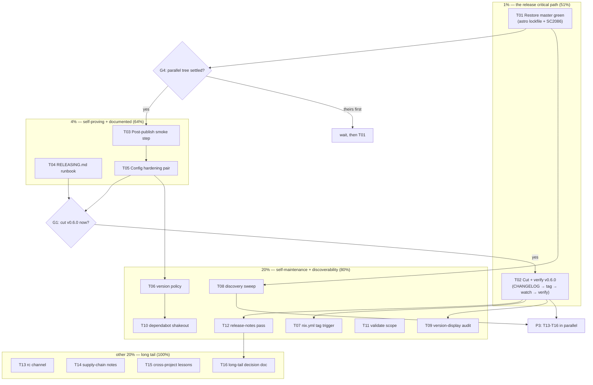

# SUPERB Release Pipeline — Pareto Execution Plan

**Date:** 2026-11-07 06:48 CET · **Scope:** the emeet-pixyd release pipeline (GoReleaser config, `release.yml`, the release process, and its consumers) · **Source:** this morning's pipeline adoption session (`docs/status/2026-11-07_06-38_goreleaser-release-pipeline.md`) + fresh verification this turn.

**Mission:** "MAKE SURE OUR RELEASE PIPELINE IS SUPERB!" — the pipeline exists and passes every locally-checkable gate, but it has exactly one unproven link (a real tag push through CI OIDC) and master is currently red in two pre-existing jobs, which blocks tagging outright. This plan closes both.

---

## 0. Current state — verified THIS turn (not remembered)

| Fact | Evidence |
| --- | --- |
| Release `validate` job GREEN on master | `gh run list`: run 42343544679, "Release", success, 2m24s, 2026-11-07T05:37Z |
| Go tests + Nix GREEN on master | same push, runs 42343544617 / 42343544675 |
| **Website build RED** (blocks release) | run 42343544629, failure: `ERR_PNPM_OUTDATED_LOCKFILE` — manifest `astro ^7.4.7` vs lockfile `^7.4.6`; failing since 2026-11-05 (3+ consecutive red runs) — NOT this session's mdx edit (build never reached it) |
| **lint-workflows RED** (blocks release) | same run: shellcheck `SC2086` (info) at `go-test.yml:22` — the pre-existing `TEMPL_VERSION=$(grep 'a-h/templ' …)` line; my `release.yml` passed shellcheck clean |
| `nix.yml` has NO tag trigger | `sed -n '1,15p' .github/workflows/nix.yml` — `branches: [master]` + PR only |
| dependabot covers github-actions | `.github/dependabot.yml` ecosystem `github-actions`, patterns `*` |
| **`update.go` coupling (parallel session, in-flight)** | their AGENTS.md draft: update checker compares release tags "(`goreleaser` injects `vX.Y.Z`)" numerically and git-SHA builds via compare API — my `-X main.buildVersion=v{{ .Version }}` is now LOAD-BEARING for two consumers; the `v` prefix is a contract |
| Working tree has 3 parallel sessions' uncommitted files | `style.css`, `templates_templ.go`, `website/package.json`, `global.out.css`, AGENTS.md (update.go docs) — none are this plan's; none will be committed with it |
| Prior plan archived | `docs/planning/archive/2026-10-31_14-33_SUPERB-v05-release-first-pareto-plan.md` |

**Errata vs the 06:38 status report:** (1) its §c.4 "post-push smoke of the validate job" is now DONE (green run observed); (2) its §b.1 "unproven in CI" stands, but the blocking fact it missed — master red in 2 pre-existing jobs — is now known and is P0 here; (3) its §f.48 (waybar update notices) is being built by the parallel session RIGHT NOW — excluded from this plan.

---

## 1. Pareto Breakdown

### The 1% that delivers 51%
**One real, green v0.6.0 release through the pipeline.** Until a tag runs, every other item is decoration: keyless cosign, OIDC, provenance attestation, release creation, and the update-checker's semver channel are all unproven in their only real environment. The 1% is a short critical path: **restore master green → curate the CHANGELOG `[Unreleased]` into `[0.6.0]` → pre-tag gates (CI green at HEAD + local snapshot) → cut the annotated tag → watch the Release run → verify the published artifacts end to end** (assets present, checksums verify, bundle signature verifies against the release page, `--version` == tag, update.go parses it).

### The 4% that delivers 64% (the 1% + these)
- **Post-publish smoke step inside `release.yml`** — the job downloads its own freshly-published amd64 tarball, `sha256sum -c`-verifies it, runs `--version`, and asserts equality with the tag. Every future release self-proves consumability; humans never hand-verify again.
- **`RELEASING.md` runbook** — the repeatable checklist (CHANGELOG-before-tag, CI-green-at-tag, local snapshot command with the `GOWORK=off` gotcha, the version-scheme table including the update.go contract, release-vs-tag mutability rules, rc-channel process, tag-message convention). Institutional memory so release #2 doesn't depend on session recall.
- **Two config hardenings** — `persist-credentials: false` on the release checkout; cosign `--certificate-identity-regexp` tightened from `https://github.com/LarsArtmann/` to the exact workflow path.

### The 20% that delivers 80% (the above + these)
- **Goreleaser version policy resolved and documented** (recommend: keep `~> v2` — the continuous validate job catches drift, and dependabot does NOT cover the `version:` input, so an exact pin would rot manually).
- **`nix.yml` on tag pushes** (2-line trigger) — proves the flake builds at the exact release commit; aligns with "verify the delivering layer".
- **Discovery sweep** — AGENTS.md Commands block gains the snapshot command; README download anchor; `quick-start.mdx`, `cli-reference.mdx` (`--version` example), `Verify Installation` section, troubleshooting table all mention binaries where relevant.
- **Version-display consistency audit + `--version` unit-test pin** — `vX.Y.Z` (release), git SHA (nix), `dev` (go run) must all render sanely on CLI status / webStatus / Waybar; update.go's two-channel parse verified against all three shapes.
- **Dependabot shakeout** — confirm the three new SHA pins get proper bump PRs (github-actions ecosystem) without fighting the `# vX.Y.Z` comment convention.
- **Validate-job trigger scope** — decide path filters (skip `website/**`-only pushes) or document why unconditional.
- **Release-notes quality pass on the real v0.6.0 output** — judge commit-derived notes vs curated; tune `changelog.filters` (add `^ci:`/`^build:`?) and header/footer wording from evidence.

### The other 20% to reach 100% (demand-gated / long tail)
Prerelease (rc) channel documentation; SBOM (deferred, trigger recorded); nfpm `.deb`/`.rpm` (needs non-Nix demand); retroactive v0.5.0 assets (needs Lars's call); tag protection rule (repo admin); red-release fix-forward drill in a fork; provenance-subjects doc note; SystemNix goreleaser pin; `GORELEASER_CURRENT_TAG` assumption note; `install.sh` evaluation; cross-project lesson record (crush-config `lessons.md`); `GOOS=darwin` failure proof recorded in the runbook; post-first-release config prune; landing-page download button; `changelog.mdx` sync check; monitoring guide `--version` triage note; flake version-contract check (`nix run .#… -- --version` in a flake check).

**Explicitly out of scope (not this plan's job):** the parallel session's update-notices feature (waybar/web footer — theirs, in flight), TODO #202/#203 buildflow debt, all hardware items (#138–#150), website dep-sweep ownership (parallel session owns the dirty tree; this plan only needs master green to tag).

---

## 2. Gates & Decision Queue (cannot be executed by willpower alone)

| # | Decision | Owner | Default if unanswered |
| --- | --- | --- | --- |
| G1 | Cut v0.6.0 when master is green, or wait for the next feature batch? | Lars | Cut as soon as green — pipeline proof outranks feature content |
| G2 | goreleaser version: keep floating `~> v2` or pin exact? | Lars | Keep `~> v2`, rationale documented (validate job = continuous drift guard; no dependabot coverage for the input) |
| G3 | Tag protection on `v*` (repo settings, admin) | Lars | Skip; single-maintainer repo today |
| G4 | Astro lockfile drift fix — this plan fixes it after the parallel session's tree settles, or they own it? | Lars / parallel session | This plan syncs the lockfile only when the tree is clean of their changes |
| G5 | Retroactive v0.5.0 binaries? | Lars | No — v0.6.0 supersedes |

---

## 3. Comprehensive Plan — medium tasks (30–100 min, ALL TODOs, sorted by impact/effort/customer-value)

| # | Task | Includes (status-report §f items) | Impact | Effort | Value |
| --- | --- | --- | --- | --- | --- |
| T01 | **Restore master green** — sync astro lockfile after parallel tree settles + full website battery; fix SC2086 in go-test.yml templ step; confirm both jobs green | f.4-adjacent (blocking) | HIGH | M | Unblocks everything |
| T02 | **Cut and verify v0.6.0 end to end** — CHANGELOG curation, pre-tag gates, annotated tag, push, watch Release run, verify assets + checksums + cosign bundle + provenance on the release page, `--version` == tag | f.1, f.2-part, f.12 | HIGHEST | M | The 51% |
| T03 | **Wire the post-publish smoke step** into `release.yml` (download, verify, run, assert tag; benign failure mode — publish already completed) | f.6 | HIGH | S/M | Self-proving releases |
| T04 | **Write `RELEASING.md`** — full runbook: checklists, commands, gotchas (GOWORK, snapshot-does-not-skip-signing), version-scheme table (+ update.go contract), mutability rules, rc channel, tag-message convention, GOOS=darwin proof note | f.2, f.36, f.43, f.38, f.47 | HIGH | M | Repeatability |
| T05 | **Config hardening pair** — `persist-credentials: false`; cosign identity regexp tightened; actionlint + local snapshot re-verify | f.8, f.7 | MED | S | Supply-chain tightness |
| T06 | **Goreleaser version policy decision + documentation** (recommend keep `~> v2` with rationale in workflow comment + runbook) | f.5, f.41 | MED | S | No-rot policy |
| T07 | **`nix.yml` tag trigger** + verify a tag build once (or documented no) | f.10 | MED | S | Flake-at-tag proof |
| T08 | **Discovery sweep** — AGENTS.md Commands, README anchor, quick-start, cli-reference `--version`, Verify Installation, troubleshooting row | f.20, f.18, f.19, f.31-adjacent | MED | S | Users find binaries |
| T09 | **Version-display audit + `--version` test pin** — three shapes (`vX.Y.Z`/SHA/`dev`) across CLI status, webStatus, Waybar; unit test; read-only check of update.go's parse tolerance | f.25, f.26, f.48-coordination | MED | S/M | Trustworthy version surfaces |
| T10 | **Dependabot shakeout** on the three new pins | f.9 | MED | S | Self-maintaining pins |
| T11 | **Validate-job scope decision** (path filters vs unconditional) + apply + document | f.28 | LOW/MED | S | CI minutes |
| T12 | **Release-notes quality pass** on real v0.6.0 output; tune filters/wording | f.24, f.37 | MED | S | Release pages worth reading |
| T13 | **Prerelease (rc) channel documented** — `prerelease: auto` semantics, rc cut process in runbook, "Latest" designation behavior | f.38, f.13-part | LOW | S | Future rc path |
| T14 | **Supply-chain extras decision record** — provenance-subjects note, SBOM trigger restated, verify-instructions placement (release footer) sanity check | f.44, f.14, f.42 | LOW | S | Documented posture |
| T15 | **Cross-project lessons committed** to crush-config `references/lessons.md` (snapshot-signing lesson + goreleaser-on-Nix-host gotchas) + this plan's errata | f.13 | LOW/MED | S | Other projects benefit |
| T16 | **Long-tail decision doc** — one ROADMAP/decision entry each for nfpm, retro-v0.5.0, install.sh, tag protection, red-release drill, config prune — each with trigger + owner | f.15, f.17, f.45, f.46, f.50, f.11 | LOW | S/M | 100% has a map |

## 4. Fine Breakdown — ALL TODOs at ≤12 min each (sorted by tier → task order)

### Tier 1% — the release critical path

| # | Task | Min |
| --- | --- | --- |
| 1.1 | Check parallel sessions' tree settled (`git status`; astro package.json/lockfile consistency) | 5 |
| 1.2 | Sync `website/pnpm-lock.yaml` with manifest (`pnpm install --lockfile-only` in website/), commit | 8 |
| 1.3 | Run full website battery locally (audit / frozen-lockfile / tsc / build / html-validate) | 12 |
| 1.4 | Fix SC2086 in go-test.yml templ step (`templ@"${TEMPL_VERSION}"`), actionlint locally | 8 |
| 1.5 | Commit both fixes with detailed messages; watch both jobs go green on master | 10 |
| 1.6 | Curate CHANGELOG `[Unreleased]` → `[0.6.0] - 2026-11-07` (Added/Changed/Fixed), leave empty `[Unreleased]` placeholder | 12 |
| 1.7 | Pre-tag gates: `gh run list` green at HEAD; `GOWORK=off goreleaser check`; local snapshot `--skip=publish --skip=sign` green | 10 |
| 1.8 | Write annotated tag `v0.6.0` (headline features, not every commit); verify `git tag --points-at HEAD` + `git show v0.6.0:go.mod` | 8 |
| 1.9 | Push master + tag; watch the Release workflow (verify → release) | 10 |
| 1.10 | Verify the release page: 2 tarballs + checksums.txt + checksums.txt.bundle.json + provenance attestation present | 8 |
| 1.11 | Download tarball in /tmp: `sha256sum -c`, extract, run `--version`, assert `v0.6.0`; cosign verify-blob against the bundle per the release footer | 10 |
| 1.12 | Verify update.go consumed the release: hit the daemon's `/api/status` (or logs) for the update verdict parsing `v0.6.0` | 8 |
| 1.13 | Flip CHANGELOG `[0.6.0]` link refs; CHANGELOG-clean final state | 6 |

### Tier 4% — self-proving + documented

| # | Task | Min |
| --- | --- | --- |
| 4.1 | Add post-publish smoke step to release.yml (checkout-free: curl release assets → sha256sum -c → extract → --version assert) | 12 |
| 4.2 | Local actionlint/yamllint/dprint on release.yml; commit smoke step | 6 |
| 4.3 | Draft RELEASING.md skeleton: pre-tag checklist, cut steps, post-tag verification | 12 |
| 4.4 | Add version-scheme table (`vX.Y.Z` release / SHA nix / `dev` go run; update.go two-channel contract) | 8 |
| 4.5 | Add gotchas: GOWORK=off, snapshot-does-not-skip-signing, GOOS=darwin fails (run once, paste error), release-vs-tag mutability | 10 |
| 4.6 | Add rc-channel section (`prerelease: auto`, rc cut process, Latest-designation semantics) | 8 |
| 4.7 | Link RELEASING.md from AGENTS.md Commands block + README contribute section | 5 |
| 4.8 | `persist-credentials: false` on release-job checkout | 4 |
| 4.9 | Tighten cosign regexp to exact workflow path; local snapshot re-verify | 6 |
| 4.10 | Commit + push hardenings; validate job green | 6 |

### Tier 20% — self-maintenance + discoverability

| # | Task | Min |
| --- | --- | --- |
| 20.1 | Document goreleaser `~> v2` rationale in release.yml comment (validate job = drift guard; dependabot can't bump the input) | 6 |
| 20.2 | Add tag trigger to nix.yml; actionlint; commit | 6 |
| 20.3 | Watch first tag-push nix build green (or fold into 1.9's watch) | 8 |
| 20.4 | Add snapshot command to AGENTS.md Commands block | 4 |
| 20.5 | README: add download anchor link + verify the Download section reads against real v0.6.0 URLs | 8 |
| 20.6 | quick-start.mdx: add binary-download fast path (≤10 lines) | 8 |
| 20.7 | cli-reference.mdx: fix `--version` example output shape | 5 |
| 20.8 | Verify Installation section + troubleshooting table: mention binaries where build-from-source is implied | 8 |
| 20.9 | Sweep version surfaces: CLI status line, webStatus JSON, Waybar JSON with `v0.6.0`-shaped buildVersion — screenshot/grep each | 12 |
| 20.10 | Write `TestVersionFlag`-style pin (dev default + injected value round-trip) | 10 |
| 20.11 | Read-only review of update.go's two-channel parse vs the three shapes; note findings for the parallel session | 10 |
| 20.12 | Dependabot: inspect first github-actions PR on the new pins (or trigger one); verify SHA+comment convention preserved | 10 |
| 20.13 | Validate-job scope: implement path filter OR document unconditional choice in workflow comment | 8 |
| 20.14 | Read real v0.6.0 auto-notes; list noise commits that slipped through | 8 |
| 20.15 | Tune changelog filters (add `^ci:`/`^build:` if warranted) + header/footer wording; commit | 8 |

### Tier other-20% — long tail, each with a trigger

| # | Task | Min |
| --- | --- | --- |
| X.1 | Provenance-subjects note (checksums.txt covers tarballs transitively) into RELEASING.md supply-chain section | 5 |
| X.2 | CHANGELOG-in-tarball decision (default: no — CHANGELOG is on the release page) recorded | 4 |
| X.3 | ROADMAP entry: nfpm deb/rpm (trigger: first non-Nix Linux user asks) | 5 |
| X.4 | ROADMAP won't-do entry: Docker/Homebrew/Scoop (Linux-only daemon) | 5 |
| X.5 | ROADMAP entry: retroactive v0.5.0 assets (trigger: Lars says someone needs v0.5 binaries) | 5 |
| X.6 | ROADMAP entry: install.sh (trigger: copy-paste friction reported) | 5 |
| X.7 | Tag protection noted as Lars-admin action (G3) in decision queue | 3 |
| X.8 | Fork drill plan: rehearse red-release fix-forward on a throwaway tag (trigger: before first big release) | 8 |
| X.9 | crush-config lessons.md: commit snapshot-signing + Nix-host goreleaser lessons (cross-repo) | 10 |
| X.10 | `GORELEASER_CURRENT_TAG` single-tag assumption into RELEASING.md | 4 |
| X.11 | Landing-page download button proposal → website session's queue | 8 |
| X.12 | changelog.mdx sync check (does the website changelog page mirror CHANGELOG.md mechanically?) | 6 |
| X.13 | monitoring.mdx: add `--version`-in-issue-triage note | 5 |
| X.14 | flake check candidate: `nix run .#emeet-pixyd -- --version` prints the store rev (contract pin; vendorHash-safe, no dep change) | 10 |
| X.15 | Post-first-release prune reminder: re-read `.goreleaser.yaml` against real output (calendar note in RELEASING.md) | 4 |

## 5. Execution Graph

**Order rationale:** T01 unblocks everything (red master forbids tagging). T03/T05/T04 are wired BEFORE the first tag so v0.6.0 exercises the smoke step too (benign failure mode: publish completes, smoke failure is a visible red X, fix-forward). T02 is the release. Everything in the 20% tier is safe to run after the release in parallel. The long tail is documentation/decision work, not code.

## 6. Verschlimmbesser guards (what this plan will NOT do)

- Not touch the parallel sessions' uncommitted files or commit them with this plan's work (stage explicit paths only).
- Not re-cut, move, or delete any tag; a bad release is fix-forward, a bad GitHub Release (not tag) may be redrafted.
- Not add SBOM/nfpm/install.sh without their recorded triggers.
- Not "fix" the floating `~> v2` into a rot-prone exact pin without G2.
- Not change `update.go` or the website feature work — that's the parallel session's; this plan only verifies the version contract it depends on.
- Every workflow/config change re-passes actionlint + yamllint (exact CI configs) + dprint + a local snapshot before commit.

## 7. Errata / staleness record (skill Step 0)

- 06:38 status report §c.4 (post-push smoke of validate) → DONE, observed green (run 42343544679).
- Master red in website + lint-workflows jobs since 2026-11-05 — discovered this turn, NOT caused by the release-pipeline session; now P0/T01.
- §f.48 (waybar update notices) → owned by the parallel update-notices session; excluded here.
- Prior plan path moved to `docs/planning/archive/` — TODO_LIST references updated accordingly (its link text still says `docs/planning/`; harmless, noted).
- All §f items from the 06:38 report are mapped into §3/§4 above or explicitly excluded with reasons.
