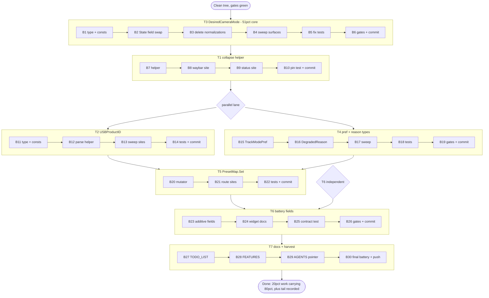

# Pareto Plan — Type Safety Migrations + Layout Follow-ups

**Created:** 2026-11-07 07:16 CET
**Sources:** `docs/reviews/2026-11-07_data-model-and-layout-review.html` (8 findings, I1–I8), `docs/status/2026-11-07_06-40_architecture-layout-qa-session.md` (§f tasks), `docs/adr/2026-11-07_flat-layout-modularization-gate.md`, TODO_LIST.md (conflict check: no overlap; hardware items stay externally blocked).
**Principle:** every migration is additive, JSON-byte-stable, independently revertable, and gated (build + race tests + erraudit strict + golangci-lint 0-issue bar) before its commit.

## The question: what delivers the result?

The daemon works. Customers feel exactly two classes of failure: **wrong state shown/acted on** (intent corruption, surface drift) and **missing convenience** (battery styling in bar widgets). Everything else in the inventory is internal hygiene that pays off as future-refactor leverage. Hence:

### 1% → 51% (the vital core)

| Task | Why it carries half the result |
|---|---|
| **T3 — `DesiredCameraMode` type** (review I1) | One type swap deletes three runtime guards (loadState normalization, saveState normalization, `ValidDesired()` filtering) and makes the intent-corruption bug class *uncompilable* — the same class that produced the real v1 bug (persisted `"offline"` clobbering user intent, ADR 2026-10-01) and an entire split-brain test file. Root cause #1 of the review, alone worth more than the other seven findings combined. |

### 4% → 64%

| Task | Added value over the 1% |
|---|---|
| **T1 — `DisplayCameraState` helper** (I2) | Single-sources the offline-collapse rule now hand-rolled twice (waybar.go:49–51, device.go:481–490); the next human surface can't drift. Must land *after* T3 so the helper takes the final type once — no double-touch. |
| **T6 — additive battery fields in `/api/status`** (I7) | The only *user-visible feature* in the inventory: bar-widget users can style charging state without parsing display strings. Additive per the stable-contract doctrine. |

### 20% → 80%

| Task | Added value |
|---|---|
| **T2 — `USBProductID` alias** (I3) | Closes the two-ID-spaces-one-type hazard (process PID branded, USB PID raw `int64`); compiler finds every site. |
| **T4 — `TrackModePref` + `DegradedReason`** (I4, I5) | Removes the string-next-to-its-own-enum (TrackMode) and the typo-prone prefix union (degraded reasons). |
| **T7 — docs sync / HARVEST** | This plan's tasks land in TODO_LIST/FEATURES/AGENTS.md so the next session inherits state, not scrollback. |

### The other 20% → 100%

| Task | Why it's in the tail |
|---|---|
| T5 — `PresetMap.Set` validated mutator (I6) | Real but narrow: write sites are few and already validated by convention. |
| Deferred: cosmetic `cmd/`+`internal/daemon/` move | ADR-deferred until Lars calls it (root listing noise vs churn). |
| ROADMAP: view-struct unification | Rejected for now (decision D2) — single-source the rule first, unify views only when a 5th surface appears. |
| ROADMAP: god-struct decomposition sketch (`hidTransport`/`streamServer`/`callDetector`) + DI interfaces | Prerequisite for real sub-packages; only valuable after T3-style typing lands. T3 is its first step. |
| TODO #172 shared V2 query helper | Trigger (4th GET family) still not met. |
| Externally blocked (not planned here): #129/#150/#154/#156/#166/#200/#204 | Hardware sessions, GitHub settings, Actions suspension — outside code-adjacent scope. |

## Plan A — Tasks, 30–100 min each (ranked by importance/impact/effort/customer-value)

| Rank | Task | Steps | Impact | Effort | Customer value | Depends on |
|---|---|---|---|---|---|---|
| 1 | **T3 DesiredCameraMode** — new alias + consts in `internal/pixy`; `State.Camera` field swap; delete load/save normalization + `ValidDesired` callers; projection for display surfaces; update split-brain/behavior/golden tests | A1–A6 → micro plan B | **HIGH** | 60–100 min | HIGH (correctness: intent can no longer be corrupted at compile time) | — |
| 2 | **T1 DisplayCameraState dedupe** — helper in `internal/pixy` taking `(online bool, DesiredCameraMode)`; waybar + getStatus call it; table-driven pin test | B7–B10 | HIGH (drift-proofing) | 30–45 min | MED (surfaces can't show wrong state) | T3 |
| 3 | **T6 additive battery fields** — `batteryPercent,omitzero` + `batteryCharging,omitzero` in statusResponse; legacy `battery` string untouched; quickshell.mdx + FEATURES row | B15–B19 | MED | 45–90 min | **HIGH** (only visible feature win) | — |
| 4 | **T2 USBProductID alias** — type + consts + `ParseUSBProductID`; sweep registries, Config, ResolveProductID, probe/uevent sites | B11–B14 | MED | 30–45 min | LOW (internal safety) | — |
| 5 | **T4 TrackModePref + DegradedReason** — two alias types; `Effective()` owner; `ExternalDepReason(binary)` constructor; wire strings byte-identical | B20–B24 | MED | 45–60 min | LOW–MED | — |
| 6 | **T5 PresetMap.Set** — validated mutator (name + IsFull); route CLI/push/web write sites | B25–B27 | LOW–MED | 30–45 min | LOW | — |
| 7 | **T7 docs sync + HARVEST** — TODO_LIST rows for landed/deferred work; FEATURES notes; AGENTS.md pointer to ADR + review | B28–B31 | MED (session continuity) | 30–45 min | LOW | all code tasks |

Every task ends with the full gate battery + its own commit (rollback = `git revert` of exactly one task).

## Plan B — Micro-tasks, ≤12 min each (complete decomposition of ALL todos)

| # | Micro-task | ≤12 min? | Task |
|---|---|---|---|
| B1 | Add `DesiredCameraMode` alias + 3 consts + `CameraState()` projection in `internal/pixy/pixy.go` (or new `desired.go`) | ✓ | T3 |
| B2 | Swap `State.Camera` field type + `DefaultState()`; JSON tag stays `"camera"` | ✓ | T3 |
| B3 | Delete `ValidDesired()` callers: loadState normalization block + saveState normalization block (state.go) | ✓ | T3 |
| B4 | Sweep display sites: waybar.go, device.go (getStatus, sync paths), commands.go, handlers.go — insert projection where a `CameraState` is required | 2× (pixy-facing / daemon-facing) | T3 |
| B5 | Update tests: state_split_brain_test (wire oracle), behavior/web goldens, hid.go map key sites | 2× | T3 |
| B6 | Gate battery (build, `go test -race -count=1`, erraudit strict, golangci-lint) + commit T3 with detailed message | 2× (gate / commit) | T3 |
| B7 | Add `DisplayCameraState(online bool, DesiredCameraMode) CameraState` next to the projection | ✓ | T1 |
| B8 | waybar.go: replace inline collapse (lines 48–51) with the helper | ✓ | T1 |
| B9 | device.go getStatus: replace early-return collapse with helper-driven branch | ✓ | T1 |
| B10 | Table-driven pin test (online×{idle,tracking,privacy} → passthrough; !online → offline) + gates + commit | 2× | T1 |
| B11 | Add `USBProductID int64` + retype product-ID constants in `internal/pixy/model.go` | ✓ | T2 |
| B12 | Add `ParseUSBProductID(string)`; refactor `ParseExtraProductIDs` onto it | ✓ | T2 |
| B13 | Sweep `Config.ExtraProductIDs`, registries, `ResolveProductID`, probe/uevent call sites (compiler-driven) | 2× | T2 |
| B14 | Model/extra-ID tests + gates + commit | 2× | T2 |
| B15 | Add `TrackModePref` alias + `Effective()`; swap `State.TrackMode` (tag stays `trackMode`) | ✓ | T4 |
| B16 | Add `DegradedReason` + two consts + `ExternalDepReason()`; retype degraded.go map + mark/clear signatures | ✓ | T4 |
| B17 | Sweep webStatus/statusResponse `Reasons` + web panel banner sites (`.String()` where raw strings needed) | ✓ | T4 |
| B18 | Update track-mode + degraded tests (TypoReasonCanary: unknown reason key no longer compiles → assert via constructor only) | ✓ | T4 |
| B19 | Gates + commit T4 | 2× | T4 |
| B20 | Add `PresetMap.Set(name string, v PTZValues) error` running `ValidatePresetName` + `IsFull` | ✓ | T5 |
| B21 | Route preset write sites (CLI set, `preset push` mirror, web handler) through `Set` | 2× | T5 |
| B22 | Preset mutation tests (invalid name rejected, over-full rejected) + gates + commit | 2× | T5 |
| B23 | Add `batteryPercent,omitzero` + `batteryCharging,omitzero` to statusResponse; populate from `powerStatus` | ✓ | T6 |
| B24 | Update `website/src/content/docs/guides/quickshell.mdx` field table (additive rows) | ✓ | T6 |
| B25 | Widget-contract test: assert legacy `battery` string unchanged + new fields present when reading | ✓ | T6 |
| B26 | Website frozen-lockfile/tsc/html-validate battery (if site docs changed) + gates + commit | 2× | T6 |
| B27 | TODO_LIST: mark review findings landed; add deferred rows (view unification, decomposition sketch) with trigger conditions | ✓ | T7 |
| B28 | FEATURES.md: note typed intent model + additive battery fields | ✓ | T7 |
| B29 | AGENTS.md: one pointer line to the ADR + review in the Architecture section (no duplication — link, don't restate) | ✓ | T7 |
| B30 | Full final battery: build, race suite, erraudit strict, lint, `nix build .#emeet-pixyd`; commit + push docs | 2× | T7 |

(31 micro-tasks ≈ Plan A's 7 tasks; nothing in the session inventory is left uncovered — rejected/deferred items are recorded as rows, not silently dropped.)

## Execution graph

## Verschlimmbesser guards — do NOT do these

1. **No JSON contract breaks.** `State` tags (`camera`, `trackMode`, `v`), `statusResponse` legacy fields, and waybar output stay byte-stable; schema version stays `2`. Wire format changes are forbidden without a schema-version bump decision.
2. **Do not merge `SpeedValues`/`PTZValues`** (decision D4) and **do not unify the four view structs** (decision D2) — both re-create the intent/observation conflation this plan removes.
3. **No package moves** (cmd/internal/daemon) — ADR-deferred; not in this plan.
4. **templ discipline:** never regenerate with anything but the go.mod-pinned CLI (`nix develop -c env GOWORK=off go run github.com/a-h/templ/cmd/templ@v0.3.1100 generate`); the 2026-11-07 0.3.1020 drift broke the build once already today.
5. **One task = one commit.** A rollback must never span two migrations.
6. **Gates before every commit** — the auto-commit daemon's build gate holds broken trees, but lint/erraudit/race are this plan's own bar.
7. **Touch nothing in `update.go` / website styles** that arrived from concurrent sessions — not this plan's scope.

## Verification

Each Plan A row's last micro-task runs: `GOWORK=off go build ./...` · `GOWORK=off go test -race -count=1 ./...` · erraudit strict (0 expected) · `GOWORK=off golangci-lint run` (0-issue bar) · `nix build .#emeet-pixyd` at T7. T6 additionally: `pnpm audit`, `pnpm install --frozen-lockfile`, `tsc -p . --noEmit`, `pnpm run build`, `html-validate dist` inside `website/` if docs changed there.
