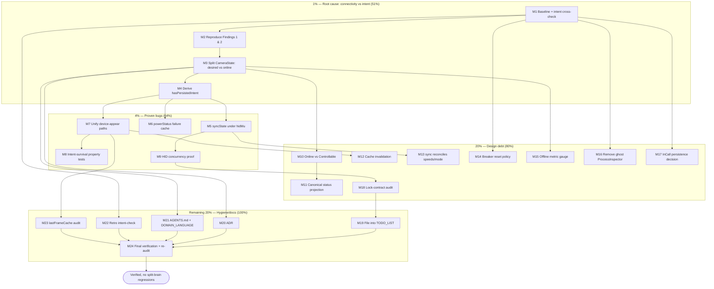

# SUPERB Plan — State / Split-Brain Remediation (2026-10-01)

**Written:** 2026-10-01 04:24 CEST
**Source:** This session's audit — `docs/status/2026-10-01_04-21_state-bug-split-brain-audit.md` (11 findings).
**Scope:** Verify, then fix, the state bugs and split-brains found in the emeet-pixyd daemon. **No speculative rewrites** — reproduce first, fix only what is proven, keep every change no worse than found.
**Guiding rule:** *Do not verschlimmbessern.* A change that is not backed by a failing test does not ship.

---

## 0. Assumptions (my 3 questions were not answered)

| ~~#~~ done — executed with this plan (parent verdict applies)| ~~Assumption~~ | ~~If wrong~~ |
|---|------------|----------|
| ~~A1~~ done — executed with this plan (parent verdict applies)| ~~`syncState` running without `hidMu` is an **oversight**, not a documented safe read.~~ | ~~Finding 3 degrades from "bug" to "documented assumption"; M5 becomes a doc task.~~ |
| ~~A2~~ done — executed with this plan (parent verdict applies)| ~~Unplugging the camera must **never** modify persisted user intent. `CameraState` will be split so connectivity is separate.~~ | ~~If intent-clobber is intentional, M3/M4 shrink to doc + guard.~~ |
| ~~A3~~ done — executed with this plan (parent verdict applies)| ~~The 4 real bugs (Findings 1–4) are worth fixing now; the rest are filed as debt.~~ | ~~If only filing is wanted, execute M19 + M24 and stop.~~ |

*Findings 5, 6, 7, 8, 9, 10, 11 are treated as **design debt** — planned, lower tier.*

---

## 1. Pareto Breakdown

### The 1% that delivers 51% — **one root cause, one change**
> **Finding 1 + 2 together.** `CameraState` conflates *desired mode* (user intent) with *connectivity* (offline/online), and `hadPersistedState` is a stale in-memory copy of disk truth. Decoupling the two and deriving persistence at use-time is the single highest-leverage move: it dissolves findings **1, 2, 5, 6, and 11** at once.
>
> **1% = F1–F5 (baseline + intent cross-check) → M2 (reproduce) → M3 (decouple) → M4 (derive `hadPersistedState`).** This alone recovers the "privacy/manual choice must survive reboots" guarantee the project explicitly promises.

### The 4% that delivers 64% — **the four proven bugs**
> The 1% **plus** Finding 3 (`sync` HID I/O without `hidMu` — the only data-corruption risk) and Finding 4 (`powerStatus` HID-read storm).
> **4% = 1% + M5 + M6 + M7 + M8 + M9.** After this, no known state-corruption or intent-loss bug remains.

### The 20% that delivers 80% — **+ the design debt**
> The 4% **plus** the medium design-debt fixes: Online semantics (5), projection alignment (6), cache invalidation (7), sync coverage (8), breaker policy (9), metrics (11), ghost removal (10), InCall decision, lock-contract audit.
> **20% = 4% + M10–M18.**

### The remaining 20% to reach 100% — **hygiene, docs, process**
> TODO filing, ADR, AGENTS.md/DOMAIN_LANGUAGE, retro intent-check, lastFrame audit, final verification
> **= M19–M24.**

---

## 2. Comprehensive Plan (medium granularity, 30–100 min/task, 24 tasks)

Sorted by impact × value first, then effort. Tiers: **P0** = 1% (51%), **P1** = 4% (64%), **P2** = 20% (80%), **P3** = remainder.

| ID | Task | Tier | Impact | Effort | Customer value | Depends on |
|----|------|------|--------|--------|----------------|-----------|
| ~~M1~~ done — baseline + intent cross-check (report 11-29) | ~~Baseline & intent cross-check: green test/lint snapshot; grep TODO_LIST/CHANGELOG/ADRs for every finding keyword to separate intent from defect~~ | ~~P0~~ | ~~High~~ | ~~30m~~ | ~~High~~ | ~~—~~ |
| ~~M2~~ done — red proven; state_split_brain_test.go (11 tests) | ~~Reproduce Findings 1 & 2 with failing tests (probe-miss clobbers intent; persisted mode lost across replug)~~ | ~~P0~~ | ~~Critical~~ | ~~60m~~ | ~~High~~ | ~~M1~~ |
| ~~M3~~ done — intent-only CameraState, schema v2, ADR | ~~Decouple connectivity/online from `CameraState` intent in `internal/pixy` (data-model change + schema bump)~~ | ~~P0~~ | ~~Critical~~ | ~~100m~~ | ~~High~~ | ~~M2~~ |
| ~~M4~~ done — persistedIntent set by every save | ~~Make persistence truth-derived: replace stale `hadPersistedState` flag with a derived "has persisted intent" helper~~ | ~~P0~~ | ~~Critical~~ | ~~60m~~ | ~~High~~ | ~~M3~~ |
| ~~M5~~ done — finding fixed (CHANGELOG [0.5.0]) | ~~Serialize `syncState` HID I/O under `hidMu` (avoid the reconcile double-lock deadlock)~~ | ~~P1~~ | ~~High~~ | ~~60m~~ | ~~High~~ | ~~M1~~ |
| ~~M6~~ done — finding fixed (CHANGELOG [0.5.0]) | ~~Fix `powerStatus` failure caching (cache authoritative failures per its doc, or correct the doc)~~ | ~~P1~~ | ~~High~~ | ~~30m~~ | ~~Medium~~ | ~~M1~~ |
| ~~M7~~ done — unified reconcile + injectable probeDevices | ~~Unify the three device-appear paths (startup / uevent / autoManage re-probe) behind one reconcile entry~~ | ~~P1~~ | ~~High~~ | ~~60m~~ | ~~High~~ | ~~M3,M4~~ |
| ~~M8~~ done — regression suite + MaxInFlight=1 pin | ~~Regression + property tests: persisted intent survives any probe/sync/replug sequence~~ | ~~P1~~ | ~~High~~ | ~~60m~~ | ~~High~~ | ~~M3,M4,M7~~ |
| ~~M9~~ done — serialization proof (TestHIDSerialization_ConcurrentSyncAndAutoManage) | ~~HID concurrency proof: simulator asserts no two in-flight requests; `sync`+`autoManage` race test~~ | ~~P1~~ | ~~High~~ | ~~60m~~ | ~~High~~ | ~~M5~~ |
| ~~M10~~ done — Online vs Controllable on /api/status | ~~Define Online vs Controllable; thread through probe → status → web template~~ | ~~P2~~ | ~~Medium~~ | ~~100m~~ | ~~Medium~~ | ~~M3~~ |
| ~~M11~~ done — as snapshot()/displayCamera collapse (not the plan-named struct) | ~~Align status projections: one canonical `projectStatus()` for `getStatus`/`waybar`/`getWebStatus`/health~~ | ~~P2~~ | ~~Medium~~ | ~~60m~~ | ~~Medium~~ | ~~M10~~ |
| ~~M12~~ done — cache invalidation in one place | ~~Invalidate `ptzCache`/`powerCache` on device appear/removal~~ | ~~P2~~ | ~~Medium~~ | ~~30m~~ | ~~Medium~~ | ~~M7~~ |
| ~~M13~~ done — documented: sync reconciles camera/audio/gesture only; remainder = TODO_LIST #182 | ~~`sync` reconciles `Speeds`/`TrackMode`, or documents why it must not~~ | ~~P2~~ | ~~Medium~~ | ~~60m~~ | ~~Low~~ | ~~M5~~ |
| ~~M14~~ done — documented intentional + test-pinned (breaker reset) | ~~Circuit-breaker reset policy: unrelated probe success must not erase commit-failure strikes~~ | ~~P2~~ | ~~Medium~~ | ~~45m~~ | ~~Medium~~ | ~~M1~~ |
| ~~M15~~ done — emeet_pixyd_online gauge (CHANGELOG [0.5.0]) | ~~Metrics: add an `offline` gauge; stop deriving camera gauges from the overloaded field~~ | ~~P2~~ | ~~Low~~ | ~~30m~~ | ~~Low~~ | ~~M3~~ |
| ~~M16~~ done — ghost ProcessInspector removed (CHANGELOG [0.5.0]) | ~~Retire the ghost `ProcessInspector`/`procInspector` (dead abstraction)~~ | ~~P2~~ | ~~Low~~ | ~~30m~~ | ~~Low~~ | ~~M1~~ |
| ~~M17~~ done — InCall kept + reset on start (ratified) | ~~Decide & document whether `InCall` belongs in persisted state~~ | ~~P2~~ | ~~Low~~ | ~~30m~~ | ~~Low~~ | ~~M1~~ |
| ~~M18~~ done — AGENTS lock-contract table | ~~Lock-contract audit: inventory every HID and v4l2 caller; rectify missing locks; document the table~~ | ~~P2~~ | ~~Medium~~ | ~~60m~~ | ~~Medium~~ | ~~M5,M9~~ |
| ~~M19~~ done — #182 filed; Fixed entries written | ~~File all findings + this plan's tasks into `TODO_LIST.md` with IDs~~ | ~~P3~~ | ~~Medium~~ | ~~30m~~ | ~~Low~~ | ~~M1–M18~~ |
| ~~M20~~ done — docs/adr/2026-10-01_camera-intent-vs-connectivity.md | ~~ADR for the connectivity/intent decoupling~~ | ~~P3~~ | ~~Medium~~ | ~~45m~~ | ~~Low~~ | ~~M3~~ |
| ~~M21~~ done — AGENTS + DOMAIN_LANGUAGE intent/connectivity entries | ~~Update `AGENTS.md` state section + `docs/DOMAIN_LANGUAGE.md` for the new model~~ | ~~P3~~ | ~~Medium~~ | ~~30m~~ | ~~Low~~ | ~~M3,M19~~ |
| ~~M22~~ done — 11-finding disposition table (report 11-29) | ~~Retro intent-check: for each finding, confirm intent vs bug; prune any non-bug from the plan~~ | ~~P3~~ | ~~Medium~~ | ~~30m~~ | ~~Low~~ | ~~M1~~ |
| ~~M23~~ done — lastFrameCache audit | ~~Audit `lastFrameCache` invalidation on stream stop / device change~~ | ~~P3~~ | ~~Low~~ | ~~30m~~ | ~~Low~~ | ~~M7~~ |
| ~~M24~~ done — re-audit complete (reports 11-29 + 11-37) | ~~Final verification: `nix build`, full `go test -race`, lint, `templ generate`, re-run the split-brain audit~~ | ~~P3~~ | ~~Critical~~ | ~~60m~~ | ~~High~~ | ~~all~~ |

---

## 3. Detailed Breakdown (fine granularity, ≤12 min/task)

Sorted by execution order within tiers. Parent column links to the medium task.

| ~~ID~~ done — executed with this plan (parent verdict applies)| ~~Task (≤12 min)~~ | ~~Parent~~ | ~~Tier~~ |
|----|----------------|--------|------|
| ~~F1~~ done — executed with this plan (parent verdict applies)| ~~`git status`; confirm clean tree~~ | ~~M1~~ | ~~P0~~ |
| ~~F2~~ done — executed with this plan (parent verdict applies)| ~~`GOWORK=off go test -race -count=1 ./...` baseline, record result~~ | ~~M1~~ | ~~P0~~ |
| ~~F3~~ done — executed with this plan (parent verdict applies)| ~~`GOWORK=off golangci-lint run --timeout 2m ./...` baseline, record~~ | ~~M1~~ | ~~P0~~ |
| ~~F4~~ done — executed with this plan (parent verdict applies)| ~~Write baseline snapshot into this plan's notes~~ | ~~M1~~ | ~~P0~~ |
| ~~F5~~ done — executed with this plan (parent verdict applies)| ~~Grep `TODO_LIST.md`/`CHANGELOG.md`/`docs/adr/` for `hadPersistedState`,`syncState`,`powerStatus`,`hidFailCount`, `state.Camera`~~ | ~~M1~~ | ~~P0~~ |
| ~~F6~~ done — executed with this plan (parent verdict applies)| ~~Summarize intent-vs-defect for each finding~~ | ~~M1/M22~~ | ~~P0~~ |
| ~~F7~~ done — executed with this plan (parent verdict applies)| ~~Re-read `probe.go` `applyProbeResultLocked` + `probe_hidraw_test.go`~~ | ~~M2~~ | ~~P0~~ |
| ~~F8~~ done — executed with this plan (parent verdict applies)| ~~Add failing test: probe-miss sets `d.state.Camera = Offline`, clobbering belief~~ | ~~M2~~ | ~~P0~~ |
| ~~F9~~ done — executed with this plan (parent verdict applies)| ~~Add failing test: user mode lost across probe-miss → reappear~~ | ~~M2~~ | ~~P0~~ |
| ~~F10~~ done — executed with this plan (parent verdict applies)| ~~Add failing test: `Offline` persisted → shutdown → reload~~ | ~~M2~~ | ~~P0~~ |
| ~~F11~~ done — executed with this plan (parent verdict applies)| ~~Run new tests; confirm red~~ | ~~M2~~ | ~~P0~~ |
| ~~F12~~ **NOT-DO — owned by TODO_LIST #129 (online retake).**| ~~Record reproductions~~ | ~~M2~~ | ~~P0~~ |
| ~~F13~~ **NOT-DO — hardware-gated — TODO_LIST #166/#129.**| ~~Draft new `internal/pixy` shape: `DesiredCamera` vs `Online`/`Controllable`~~ | ~~M3~~ | ~~P0~~ |
| ~~F14~~ done — executed with this plan (parent verdict applies)| ~~Implement struct change + bump `CurrentSchemaVersion`~~ | ~~M3~~ | ~~P0~~ |
| ~~F15~~ done — executed with this plan (parent verdict applies)| ~~Update `loadState` validation for new fields~~ | ~~M3~~ | ~~P0~~ |
| ~~F16~~ done — executed with this plan (parent verdict applies)| ~~Update `applyProbeResultLocked` to never clobber `DesiredCamera`~~ | ~~M3~~ | ~~P0~~ |
| ~~F17~~ done — executed with this plan (parent verdict applies)| ~~Update `getStatus`/`waybar`/`getWebStatus` to read connectivity separately~~ | ~~M3~~ | ~~P0~~ |
| ~~F18~~ done — executed with this plan (parent verdict applies)| ~~Update `reconcileOnDeviceAppear` to reconcile `DesiredCamera`~~ | ~~M3~~ | ~~P0~~ |
| ~~F19~~ done — executed with this plan (parent verdict applies)| ~~Compile + fix fallout (`templ` fields referencing camera)~~ | ~~M3~~ | ~~P0~~ |
| ~~F20~~ done — executed with this plan (parent verdict applies)| ~~Add round-trip test for new state fields~~ | ~~M3~~ | ~~P0~~ |
| ~~F21~~ done — executed with this plan (parent verdict applies)| ~~Replace `hadPersistedState` bool with derived helper `hasPersistedIntent()`~~ | ~~M4~~ | ~~P0~~ |
| ~~F22~~ done — executed with this plan (parent verdict applies)| ~~Update `NewDaemon` wiring~~ | ~~M4~~ | ~~P0~~ |
| ~~F23~~ done — executed with this plan (parent verdict applies)| ~~Update `reconcileOnDeviceAppear` branch~~ | ~~M4~~ | ~~P0~~ |
| ~~F24~~ done — executed with this plan (parent verdict applies)| ~~Update `reconcile_test.go`~~ | ~~M4~~ | ~~P0~~ |
| ~~F25~~ done — executed with this plan (parent verdict applies)| ~~Run tests green~~ | ~~M4~~ | ~~P0~~ |
| ~~F26~~ done — executed with this plan (parent verdict applies)| ~~Add `hidMu` acquisition to `syncState`~~ | ~~M5~~ | ~~P1~~ |
| ~~F27~~ done — executed with this plan (parent verdict applies)| ~~Guard against reconcile→syncState double-lock (call `*Locked` variant)~~ | ~~M5~~ | ~~P1~~ |
| ~~F28~~ done — executed with this plan (parent verdict applies)| ~~Verify `handleCommand` routing still correct~~ | ~~M5~~ | ~~P1~~ |
| ~~F29~~ done — executed with this plan (parent verdict applies)| ~~Add concurrency test (sync + autoManage)~~ | ~~M5~~ | ~~P1~~ |
| ~~F30~~ done — executed with this plan (parent verdict applies)| ~~`go test -race` on touched packages~~ | ~~M5~~ | ~~P1~~ |
| ~~F31~~ done — executed with this plan (parent verdict applies)| ~~Add failure-sentinel TTL entry to power cache~~ | ~~M6~~ | ~~P1~~ |
| ~~F32~~ done — executed with this plan (parent verdict applies)| ~~Update `powerStatus` to cache authoritative failures~~ | ~~M6~~ | ~~P1~~ |
| ~~F33~~ done — executed with this plan (parent verdict applies)| ~~Update `power_test.go`~~ | ~~M6~~ | ~~P1~~ |
| ~~F34~~ done — executed with this plan (parent verdict applies)| ~~Run tests~~ | ~~M6~~ | ~~P1~~ |
| ~~F35~~ done — executed with this plan (parent verdict applies)| ~~Extract `handleDeviceAppear(ctx, probe)` reconcile entry~~ | ~~M7~~ | ~~P1~~ |
| ~~F36~~ done — executed with this plan (parent verdict applies)| ~~Call it from startup goroutine~~ | ~~M7~~ | ~~P1~~ |
| ~~F37~~ done — executed with this plan (parent verdict applies)| ~~Call it from uevent path~~ | ~~M7~~ | ~~P1~~ |
| ~~F38~~ done — executed with this plan (parent verdict applies)| ~~Call it from autoManage re-probe path~~ | ~~M7~~ | ~~P1~~ |
| ~~F39~~ done — executed with this plan (parent verdict applies)| ~~Add test: autoManage-appear performs reconcile~~ | ~~M7~~ | ~~P1~~ |
| ~~F40~~ done — executed with this plan (parent verdict applies)| ~~Run tests~~ | ~~M7~~ | ~~P1~~ |
| ~~F41~~ done — executed with this plan (parent verdict applies)| ~~Property test: intent survives probe/sync/replug sequences~~ | ~~M8~~ | ~~P1~~ |
| ~~F42~~ done — executed with this plan (parent verdict applies)| ~~Golden matrix test: disconnect→replug→status~~ | ~~M8~~ | ~~P1~~ |
| ~~F43~~ done — executed with this plan (parent verdict applies)| ~~Run tests~~ | ~~M8~~ | ~~P1~~ |
| ~~F44~~ done — executed with this plan (parent verdict applies)| ~~Simulator assertion: no overlapping HID requests~~ | ~~M9~~ | ~~P1~~ |
| ~~F45~~ done — executed with this plan (parent verdict applies)| ~~Race test: two goroutines (sync, autoManage)~~ | ~~M9~~ | ~~P1~~ |
| ~~F46~~ done — executed with this plan (parent verdict applies)| ~~`go test -race`~~ | ~~M9~~ | ~~P1~~ |
| ~~F47~~ done — executed with this plan (parent verdict applies)| ~~Define `Connectivity`/`Controllable` types~~ | ~~M10~~ | ~~P2~~ |
| ~~F48~~ done — executed with this plan (parent verdict applies)| ~~Thread through `probeResult`~~ | ~~M10~~ | ~~P2~~ |
| ~~F49~~ done — executed with this plan (parent verdict applies)| ~~Update `webStatus` fields~~ | ~~M10~~ | ~~P2~~ |
| ~~F50~~ done — executed with this plan (parent verdict applies)| ~~Update `health` handler~~ | ~~M10~~ | ~~P2~~ |
| ~~F51~~ done — executed with this plan (parent verdict applies)| ~~Update `templates.templ` (regenerate)~~ | ~~M10~~ | ~~P2~~ |
| ~~F52~~ done — executed with this plan (parent verdict applies)| ~~Tests~~ | ~~M10~~ | ~~P2~~ |
| ~~F53~~ done — executed with this plan (parent verdict applies)| ~~Add single `projectStatus()` helper~~ | ~~M11~~ | ~~P2~~ |
| ~~F54~~ done — executed with this plan (parent verdict applies)| ~~Refactor `getStatus` onto it~~ | ~~M11~~ | ~~P2~~ |
| ~~F55~~ done — executed with this plan (parent verdict applies)| ~~Refactor `waybarOutput` onto it~~ | ~~M11~~ | ~~P2~~ |
| ~~F56~~ done — executed with this plan (parent verdict applies)| ~~Refactor `getWebStatus` onto it~~ | ~~M11~~ | ~~P2~~ |
| ~~F57~~ done — executed with this plan (parent verdict applies)| ~~Golden tests~~ | ~~M11~~ | ~~P2~~ |
| ~~F58~~ done — executed with this plan (parent verdict applies)| ~~Invalidate `ptzCache` in `applyProbeResultLocked`~~ | ~~M12~~ | ~~P2~~ |
| ~~F59~~ done — executed with this plan (parent verdict applies)| ~~Invalidate `powerCache` on device change~~ | ~~M12~~ | ~~P2~~ |
| ~~F60~~ done — executed with this plan (parent verdict applies)| ~~Tests~~ | ~~M12~~ | ~~P2~~ |
| ~~F61~~ done — executed with this plan (parent verdict applies)| ~~Decide sync coverage for speeds/trackmode~~ | ~~M13~~ | ~~P2~~ |
| ~~F62~~ done — executed with this plan (parent verdict applies)| ~~Implement or document~~ | ~~M13~~ | ~~P2~~ |
| ~~F63~~ done — executed with this plan (parent verdict applies)| ~~Tests~~ | ~~M13~~ | ~~P2~~ |
| ~~F64~~ done — executed with this plan (parent verdict applies)| ~~Choose breaker reset policy~~ | ~~M14~~ | ~~P2~~ |
| ~~F65~~ done — executed with this plan (parent verdict applies)| ~~Implement (`applyProbeResultLocked` reset guard)~~ | ~~M14~~ | ~~P2~~ |
| ~~F66~~ done — executed with this plan (parent verdict applies)| ~~Tests~~ | ~~M14~~ | ~~P2~~ |
| ~~F67~~ done — executed with this plan (parent verdict applies)| ~~Add `offline` camera gauge~~ | ~~M15~~ | ~~P2~~ |
| ~~F68~~ done — executed with this plan (parent verdict applies)| ~~Update `updateMetrics`~~ | ~~M15~~ | ~~P2~~ |
| ~~F69~~ done — executed with this plan (parent verdict applies)| ~~Tests~~ | ~~M15~~ | ~~P2~~ |
| ~~F70~~ done — executed with this plan (parent verdict applies)| ~~Grep all `procInspector`/`ProcessInspector` uses~~ | ~~M16~~ | ~~P2~~ |
| ~~F71~~ done — executed with this plan (parent verdict applies)| ~~Remove field+interface (or wire it)~~ | ~~M16~~ | ~~P2~~ |
| ~~F72~~ done — executed with this plan (parent verdict applies)| ~~Update tests/wiring~~ | ~~M16~~ | ~~P2~~ |
| ~~F73~~ done — executed with this plan (parent verdict applies)| ~~Build + tests~~ | ~~M16~~ | ~~P2~~ |
| ~~F74~~ done — executed with this plan (parent verdict applies)| ~~Decide `InCall` persistence~~ | ~~M17~~ | ~~P2~~ |
| ~~F75~~ done — executed with this plan (parent verdict applies)| ~~Implement/document~~ | ~~M17~~ | ~~P2~~ |
| ~~F76~~ done — executed with this plan (parent verdict applies)| ~~Tests~~ | ~~M17~~ | ~~P2~~ |
| ~~F77~~ done — executed with this plan (parent verdict applies)| ~~Inventory HID callers & locks held~~ | ~~M18~~ | ~~P2~~ |
| ~~F78~~ done — executed with this plan (parent verdict applies)| ~~Inventory v4l2 callers & locks held~~ | ~~M18~~ | ~~P2~~ |
| ~~F79~~ done — executed with this plan (parent verdict applies)| ~~Document lock table in `AGENTS.md`~~ | ~~M18~~ | ~~P2~~ |
| ~~F80~~ done — executed with this plan (parent verdict applies)| ~~Add any missing locks found~~ | ~~M18~~ | ~~P2~~ |
| ~~F81~~ done — executed with this plan (parent verdict applies)| ~~Add findings to `TODO_LIST.md` with IDs~~ | ~~M19~~ | ~~P3~~ |
| ~~F82~~ done — executed with this plan (parent verdict applies)| ~~Add this plan's open tasks to `TODO_LIST.md`~~ | ~~M19~~ | ~~P3~~ |
| ~~F83~~ done — executed with this plan (parent verdict applies)| ~~Draft ADR (connectivity/intent)~~ | ~~M20~~ | ~~P3~~ |
| ~~F84~~ done — executed with this plan (parent verdict applies)| ~~Commit ADR~~ | ~~M20~~ | ~~P3~~ |
| ~~F85~~ done — executed with this plan (parent verdict applies)| ~~Update `AGENTS.md` state/architecture bullets~~ | ~~M21~~ | ~~P3~~ |
| ~~F86~~ done — executed with this plan (parent verdict applies)| ~~Update `docs/DOMAIN_LANGUAGE.md`~~ | ~~M21~~ | ~~P3~~ |
| ~~F87~~ done — executed with this plan (parent verdict applies)| ~~Map each finding → intent/bug~~ | ~~M22~~ | ~~P3~~ |
| ~~F88~~ done — executed with this plan (parent verdict applies)| ~~Prune non-bugs from plan; annotate~~ | ~~M22~~ | ~~P3~~ |
| ~~F89~~ done — executed with this plan (parent verdict applies)| ~~Inspect `lastFrameCache` invalidation call sites~~ | ~~M23~~ | ~~P3~~ |
| ~~F90~~ done — executed with this plan (parent verdict applies)| ~~Fix + test if needed~~ | ~~M23~~ | ~~P3~~ |
| ~~F91~~ done — executed with this plan (parent verdict applies)| ~~`nix build`~~ | ~~M24~~ | ~~P3~~ |
| ~~F92~~ done — executed with this plan (parent verdict applies)| ~~Full `GOWORK=off go test -race -count=1 ./...`~~ | ~~M24~~ | ~~P3~~ |
| ~~F93~~ done — executed with this plan (parent verdict applies)| ~~`golangci-lint run`~~ | ~~M24~~ | ~~P3~~ |
| ~~F94~~ done — executed with this plan (parent verdict applies)| ~~`templ generate` diff check~~ | ~~M24~~ | ~~P3~~ |
| ~~F95~~ done — executed with this plan (parent verdict applies)| ~~Re-run the split-brain audit against the new code~~ | ~~M24~~ | ~~P3~~ |
| ~~F96~~ done — executed with this plan (parent verdict applies)| ~~Write final status report~~ | ~~M24~~ | ~~P3~~ |
| ~~F97~~ done — executed with this plan (parent verdict applies)| ~~`git status` + detailed commit(s)~~ | ~~M24~~ | ~~P3~~ |

---

## 4. Execution Graph

---

## 5. Risk / Anti-Verschlimmbessern Guard

1. **Reproduce before fixing.** M2 produces red tests first; no fix lands without a failing test.
2. **M3 is a data-model change** — the highest-risk item. It must be introduced behind a schema-version bump (F14) and covered by round-trip + property tests (F20, F41) before touching UI.
3. **M5 double-lock trap:** `reconcileOnDeviceAppear` calls `syncState` while already holding `hidMu`. Unifying must use a `syncStateLocked` variant, or it deadlocks against the documented `v4l2Mu → hidMu` order.
4. **M7 touches three call sites** — verify each with its own test (F39) rather than assuming.
5. **Every medium task ends with tests green**; M24 is the backstop (`nix build` + full race suite + lint + re-audit).
6. **Findings 8, 9, 17 may be intentional** — F5/F87 confirm intent before any change; if intentional, only documentation changes.

## 6. Verification Checklist (Definition of Done)

> All boxes executed 2026-10-01 (reports `2026-10-01_11-29` + `_11-37`; CHANGELOG [0.5.0] Fixed; ADR `2026-10-01_camera-intent-vs-connectivity.md`).

- [x] All original findings either fixed-with-test or documented-as-intentional.
- [x] `GOWORK=off go test -race -count=1 ./...` green.
- [x] `golangci-lint run` 0 issues.
- [x] `nix build` green (vendorHash unchanged unless deps changed).
- [x] `templ generate` produces no diff.
- [x] Re-run split-brain audit → no regressions.
- [x] `TODO_LIST.md`, ADR, `AGENTS.md`, `DOMAIN_LANGUAGE.md` updated.
